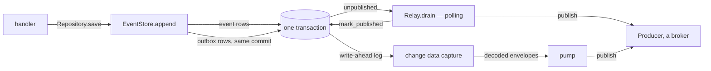
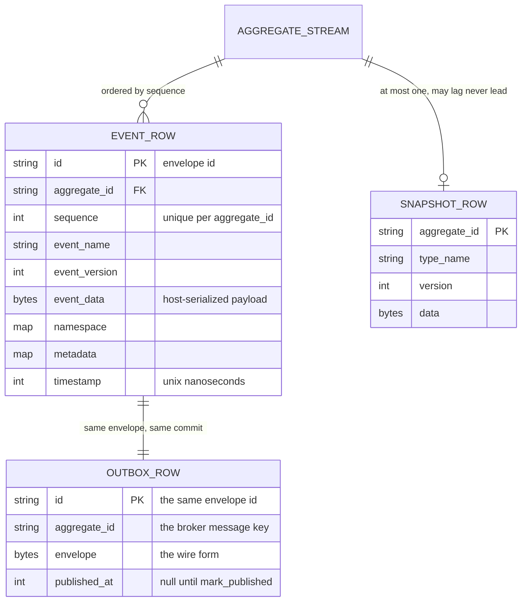
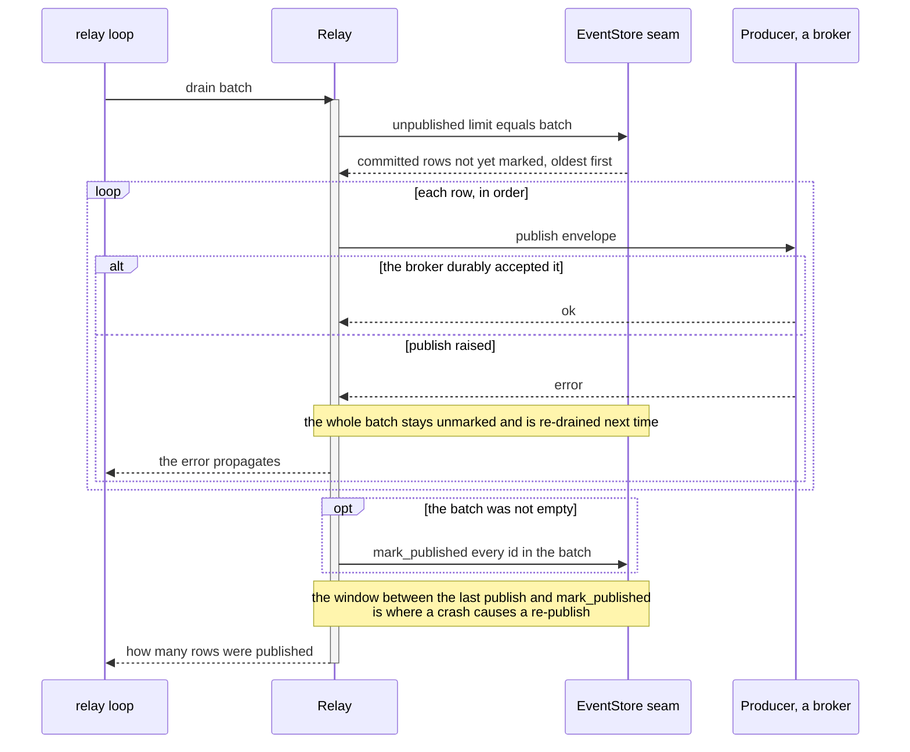
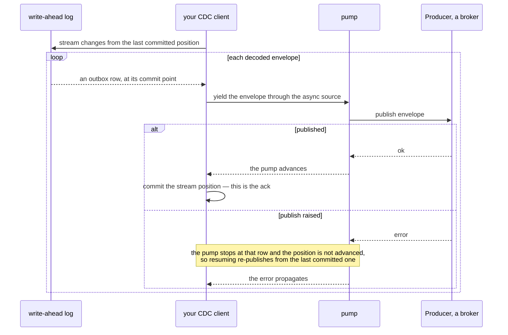

# The transactional Outbox

How `EventStore.append` writes to-publish rows beside the event rows, and how a `Relay` or a `pump`
gets them to a broker.

A service that changes state and publishes an event has two systems to write to. It cannot write to
both atomically. The transactional Outbox removes the second write from the critical path. The event
and its to-publish row commit together in one database transaction. A separate process moves the row
to the broker afterwards.



## Why a dual write cannot be made atomic

Write the row, then publish. The process dies in between: the state changed and nobody was told.
Publish, then write the row. The process dies in between: consumers acted on an event whose state
never committed. Reordering does not help, because there is no ordering of two independent commits
that survives a crash between them. Making them one commit needs a distributed transaction across a
database and a broker, which edax does not use and most brokers do not offer.

The outbox avoids it. There is only one commit, because the to-publish row **is** a database row.
The module docstrings state it:

> The outbox lives on `EventStore` rather than in a seam of its own. A transactional outbox holds
> only if the event rows and the to-publish rows commit together, and one object is the only place
> that can be guaranteed.
> — the `OutboxStore` module doc, in both SDKs

That is why there is no `OutboxStore` seam to implement. `unpublished` and `mark_published` are
methods on `EventStore` precisely so no backend can split the two writes across two systems by
accident.

The remaining gap is the publish itself, which is still a separate step and therefore still
at-least-once. That gap is bounded and recoverable: the row is durable, so a redelivery is a
duplicate, never a loss.

## Stored shapes



`EVENT_ROW` and `SNAPSHOT_ROW` mirror `EventEnvelope` and `Snapshot`. The outbox row's primary key
is the **same envelope id** as the event row's; that shared id is what a consumer deduplicates on
after a redelivery.

`published_at IS NULL` is the shape the `EventStore` docstring recommends for a polling relay on a
SQL database. It is a suggestion, not a requirement. The in-memory adapter instead prunes a row from
the outbox when it is marked. The outbox then holds only unpublished rows. `unpublished` becomes a
bounded prefix scan rather than a filter over a growing log.

## The row lifecycle


`unpublished` returns only **committed** rows, oldest commit first, and at minimum one aggregate's
rows in `sequence` order. A row staged inside an open transaction is not a row to publish; the
in-memory store enforces that by reading the outbox outside any transaction token at all.

### mark_published is idempotent

> `mark_published` is idempotent and durable. Both run outside any `tx`.
> — the `OutboxStore.mark_published` contract

Idempotent means three things concretely, and all three are tested:

| Call | Must do |
|---|---|
| ids already marked | nothing, no raise |
| ids the store never saw — a change-data-capture drain marking rows by id | nothing, no raise |
| an empty id list | nothing, no raise |

None of the three may touch the rows still waiting to publish.

This matters because the relay's own acknowledgement can be lost. The relay publishes a batch, calls
`mark_published`, and the response never arrives. It has no way to tell "the mark landed" from "the
mark did not land". So it re-drains, publishes the same rows again, and marks them again. Both
repeats must be harmless: the second publish is caught downstream by the dedup on `env.id`, the
second mark is caught by idempotence here.

## Relay.drain — polling



```python
published = await edax.Relay(store, events.publish).drain()
```

`examples/py/outbox.py:81`. `drain` publishes one batch and returns how many; call it in a loop to
keep draining. Rust's `Relay::drain(batch, publish)` takes the publish closure per call instead of
at construction; `publish` there is synchronous, so wrap it in your async runtime for a network
transport.

**What `drain` needs from the store**

| Requirement | Why |
|---|---|
| `unpublished` returns committed rows only | a staged row may still roll back |
| oldest commit first, one aggregate's rows in `sequence` order | per-key ordering downstream |
| rows stay until `mark_published` | a crash mid-batch re-delivers rather than drops |
| `mark_published` is idempotent and durable | the acknowledgement itself can be lost |

**What `drain` needs from the `Producer`**

| Requirement | Why |
|---|---|
| `publish` returns only after a **durable** broker ack | returning early lets the row be marked before the message exists — a lost event |
| `publish` **raises** on failure, never swallows | the relay leaves the batch unmarked and retries it |
| the message key is `aggregate_id` | a broker that orders per key delivers one aggregate's events in `sequence` order |

Read the `Publisher` seam in `edax.broker`. The relay calls `publish` serially, so an adapter need
not be thread-safe or reentrant.

Mark-published runs only after **every** row in the batch is published, so a failure mid-batch
re-delivers rather than drops. An empty outbox marks nothing at all — no wasted round trip.

**Run one relay per store.** The `EventStore` contract does not lease rows. Two relays would read
the same rows and double-publish. For N relays, make `unpublished` claim rows. Use a row lock that
skips rows already locked and is held until `mark_published`, or a `leased_until` column.

The Python `Relay.drain` holds an `asyncio.Lock`, so two overlapping calls on one relay cannot
double-publish. That lock is per relay, not per store. It does not help across processes.

**A dispatcher `submit` is not a valid `publish`.** `submit` only enqueues the envelope. A crash
between the enqueue and the handler loses the event, which turns the outbox into at-most-once.
`publish` must return only after the transport durably accepted the event.

## pump — fed from change data capture

Change data capture (CDC) reads the database's own write-ahead log. Because `append` already wrote
the outbox row inside the transaction, a log consumer sees that row exactly when the transaction
commits — no polling, no second query.



```python
async def wal() -> AsyncIterator[Any]:
    for i in (1, 2, 3):
        yield build_envelope("acct", "Tick", i, id=f"e{i}")


published: list[str] = []
assert await pump(wal(), lambda env: published.append(env.id)) == 3
assert published == ["e1", "e2", "e3"]
```

`test_store.py` pins that. `pump` publishes every envelope from the source until the source ends,
and returns how many.

**What `pump` needs from the store**: almost nothing. `unpublished` and `mark_published` may be
no-ops, and row retention is yours to manage. What it needs instead is a `source`: an async iterable
of `EventEnvelope`, decoded from the log with your `Serializer`.

**What `pump` needs from the `Producer`**: the same three guarantees `Relay` needs. `publish` may be
sync or async in both cases.

There is no `mark_published` in this mode. The **stream position is the acknowledgement**, so commit
it in your CDC client only after `pump` has passed the row. A raising `publish` stops the pump;
resume from the last committed position for at-least-once. The branch table pins that behaviour:
publishing `e1, e2, e3` with a failure on `e2` leaves `["e1", "e2"]` attempted, raises, and returns
no count.

### Choosing between them

| | `Relay.drain` | `pump` |
|---|---|---|
| trigger | your polling loop | the database's write-ahead log |
| latency | one poll interval | the commit itself |
| needs from the store | `unpublished` plus `mark_published` | neither |
| acknowledgement | `mark_published` by envelope id | the CDC stream position |
| concurrency | one relay per store, unless `unpublished` leases rows | whatever your CDC client supports |
| row retention | handled by `mark_published` | yours |

Satisfy one of the two; the `EventStore` contract requires exactly that.

## At-least-once publication

The same envelope can reach the broker more than once. Three windows produce it:

| Window | What happens |
|---|---|
| a crash between `publish` and `mark_published` | the row is still unpublished; the next drain publishes it again |
| a lost `mark_published` response | the relay cannot tell; it re-drains and re-publishes |
| a CDC client resuming from an uncommitted position | the log replays from there |

Publishing twice is correct behaviour, not a bug to remove. The alternative — mark first, publish
after — turns a duplicate into a **lost event**, which no downstream can recover. edax picks the
recoverable failure, in both modes.

What catches the duplicate is downstream, never the relay:

- consumers deduplicate by `env.id`, or by `dedup` on `sequence`.
- the idempotency guard claims the event id before the handler runs — see
  [idempotency](./idempotency.md).
- the end-to-end statement of what that adds up to is in [delivery
  guarantees](../guides/delivery-guarantees.md).

## Worked example

```python
async def handle(env: edax.Envelope) -> None:
    # same aggregate -> same worker -> serialized: no lock around this read-modify-write
    agg = env.aggregate_id
    balances[agg] += json.loads(env.event.data)["amount"]
    v = version[agg]
    data = json.dumps({"balance": balances[agg]}).encode()
    async with edax.transaction(store) as tx:
        await store.append(tx, agg, v, [_env(f"{agg}-ev-{v + 1}", agg, "Deposited", v + 1, data)])
    version[agg] = v + 1


dispatcher = edax.KeyOrderedDispatcher(workers=4, handler=handle)
dispatcher.start()
for _ in REQUESTS:
    await dispatcher.submit(await _poll(commands))  # worker acks after the append
await dispatcher.stop()

published = await edax.Relay(store, events.publish).drain()
```

`examples/py/outbox.py:63`. Two things to notice. The input delivery is acked only **after** the
append commits, so a crash before the commit redelivers the input rather than dropping the work.
`InMemoryBroker` is both `Producer` and `Consumer`. The same wiring runs against a real broker once
you swap in an adapter over your own client. The shape does not change.

`examples/py/command_handling.py:108` shows the other half: the outbox holds exactly the events that
committed. A dispatch that replayed from the idempotency ledger, and one rejected for a payload
mismatch, wrote nothing at all.

## See also

- [Aggregates](./aggregates.md) — `Repository.save`, which is what calls `append`.
- [Transactions](./transactions.md) — the unit of work the event rows and outbox rows share.
- [Idempotency](./idempotency.md) — the guard that catches the redelivered envelope.
- [Delivery guarantees](../guides/delivery-guarantees.md) — the end-to-end matrix.
- [Consuming](./consuming.md) — `KeyOrderedDispatcher`, the other end of a published event.
- [Kafka backend](../backends/kafka.md) — a real `Producer` behind `Relay`.
