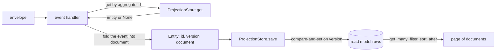
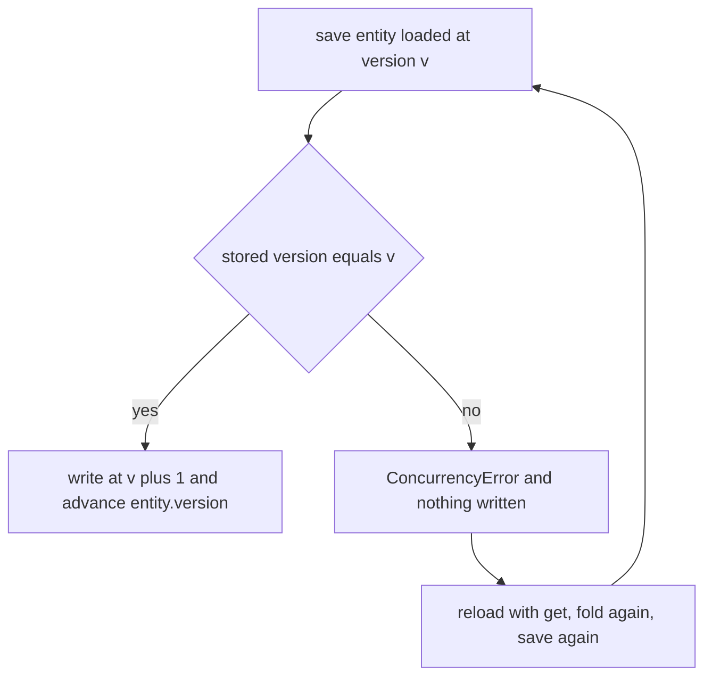
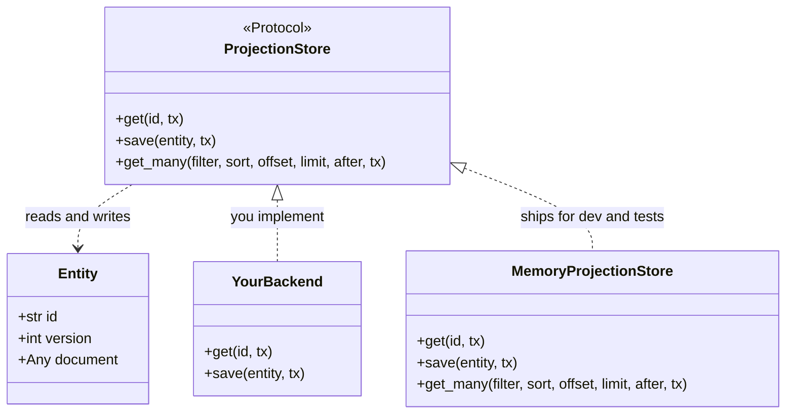
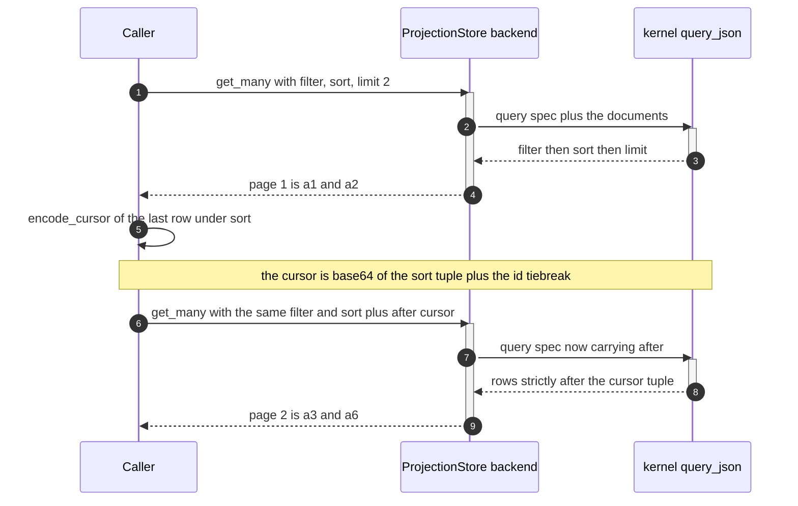

# Projections

The read side: a read model stored as one document per id, written with a version check, and paged
with semantics the kernel decides.

The event-sourced side replays events to rebuild an aggregate. A read model is the other shape: a
current document you save and query directly. `ProjectionStore` is that seam, and no concrete store
ships with edax — you bring one.



## `Entity`

Three fields, and the third carries the whole concurrency rule.

| Field | Python type | Rust type | Meaning |
|---|---|---|---|
| `id` | `str` | `String` | the row key — normally the aggregate id the projection tracks |
| `version` | `int` | `u64` | the version the entity was loaded at; `0` for one never saved |
| `document` | `Any` | `serde_json::Value` | the queryable body, a JSON object |

`version` is there because `save` is a compare-and-set, not an overwrite. The store writes at
`version + 1` only if the stored version still equals `version`. A writer that loaded version 1,
held it while another writer advanced the row to 2, and then saved, loses: it gets
`ConcurrencyError` and writes nothing. The stale writer's document never lands on top of the newer
one. On success the store advances `entity.version` in place, so the same object can be folded and
saved again without a reload.

The Rust software development kit (SDK) pins both halves of that rule. `save_versions_then_get`
asserts `e.version == 1` after the first save. `stale_version_conflicts` asserts `Error::Concurrency
{ expected: 1, stored: 2 }` for the writer whose version is stale. Python asserts the same through
`pytest.raises(ConcurrencyError)`.



## The `ProjectionStore` seam



Nothing in the SDK calls this store. Only your handlers do. That is why `get_many` is optional: a
store you never page through is a valid backend without it. `get` and `save` are what a projection
handler needs.

| Method | Must guarantee |
|---|---|
| `get(id, tx=None)` | returns the current committed row plus the `tx`'s own staged writes, or `None` |
| `save(entity, tx=None)` | compare-and-set on `entity.version`; on success advance `entity.version`, on mismatch raise `ConcurrencyError` and write nothing |
| `get_many(...)` | optional; pages by the kernel's filter / sort / keyset rules |

Two points a backend author gets wrong first.

*Enforce the version check in the database, not in your process.* A read-then-write in Python is not
a compare-and-set; two processes will interleave. Use `UPDATE ... WHERE version = ?` and check the
affected row count, or a unique insert for version 1.

*Enlist in the caller's transaction.* Every method takes an optional `tx`. With `tx` given, or with
`current_tx()` set by an enclosing `with_tx`, the store runs inside that transaction; with neither,
it auto-commits. That is what lets a projection write commit with the events that produced it. See
[transactions](./transactions.md).

### Rust and Python parity

| | Rust (`crates/edax/src/projection.rs`) | Python (`crates/edax-py/python/edax/projection.py`) |
|---|---|---|
| seam | `trait ProjectionStore` with associated `type Tx` | `Protocol ProjectionStore`, `tx` keyword argument |
| query shape | `edax_event::Query`, re-exported not re-declared | a `dict` built by `edax.query.build_spec` |
| optional method | none — a trait has no optional items | `get_many` |
| conflict | `Error::Concurrency { expected, stored }` | `ConcurrencyError` |

Rust re-exports the kernel's `Query` rather than declaring its own, so the spec the SDK serializes
is by construction the one the kernel parses. Python builds the same JSON through `build_spec`,
which is shared by `edax.query.query` and by every backend's `get_many` so the two cannot drift.

## Keeping a projection up to date

An event handler folds an envelope into an `Entity`. This is the handler from
`examples/py/event_idempotency.py:58`, unedited:

```python
async def handle(env: edax.Envelope) -> None:
    calls.append(env.id)
    entity = await projections.get(env.aggregate_id)
    if entity is None:
        entity = Entity(env.aggregate_id, 0, {"id": env.aggregate_id, "balance": 0})
    amount = int(env.event.data)
    entity.document["balance"] = entity.document["balance"] + abs(amount)
    await projections.save(entity)  # joins the guard's unit of work via current_tx()
```

Read it in four steps. Load the entity by aggregate id. Seed version `0` when the row does not
exist, so the first `save` is an insert. Fold the event into the document. Save, with no explicit
`tx`, so the store picks up the ambient transaction the guard opened.

That fold is `balance + amount`, which is not idempotent: a redelivered envelope applied twice
double-counts. The guard is what stops it, and what the guard is worth depends on whether the claim
and this `save` commit together. `examples/py/event_idempotency.py` runs both modes and asserts the
difference — balance `100` with a shared unit of work, balance `200` with a ledger of its own. See
[idempotency](./idempotency.md).

## Querying

A query is four independent parts, applied in a fixed order: **filter -> keyset(`after`) -> sort ->
offset -> limit**.

### Filter

Build it with the constructors in `edax.filter`: `eq`, `ne`, `gt`, `gte`, `lt`, `lte`,
`starts_with`, `in_`, `contains`, `exists`, and the connectives `and_`, `or_`, `not_`. Each returns
a plain dict in the kernel's canonical form. The abstract syntax tree and the null/missing rule —
why `ne(p, x)` and `not_(eq(p, x))` differ. Read them in [kernels/filter](../kernels/filter.md).

`edax.filter.matches(filter, document)` evaluates one document in process, which is how you test a
filter without a store.

### Sort, offset, limit

`sort_key(path, desc=False)` builds one ordering key. `sort` is a list of them, applied in order.

The kernel fixes a total order across JSON types. The comparator never reports "incomparable", so a
sort is deterministic whatever value types the documents hold.

| Rank | Type | Order within the type |
|---|---|---|
| 0 | number | numerically, exactly. Integers above 2^53 do not collapse |
| 1 | string | by Unicode code point |
| 2 | bool | `false < true` |
| 3 | array | none: two arrays compare equal |
| 4 | object | none: two objects compare equal |
| 5 | null | none |

A missing path reads as `null` and therefore sorts last in ascending order. Numbers and strings
order through the filter comparator, so a sort and a range filter rank the same pair identically.
The mixed-type case in `testdata/golden/query.json` expects exactly this rank order.

Multi-key sort is stable and evaluated left to right. `Query` carries `filter`, `sort`, `offset`,
`limit` and `after`. Unset fields are omitted on the way out, so a backend reading the spec sees no
phantom clauses.

Three edges the test suite pins:

- `sort=[]` is no sort, exactly as omitting it.
- `limit=0` is an empty page, not an absent limit.
- `offset` past the end is an empty page, not an error.

### Keyset cursors

`offset` re-reads the prefix on every page and drifts when rows are inserted between calls. A keyset
cursor does not: it names the last row of the page, and the next page starts *strictly* after it.
Generate one with `encode_cursor(document, sort)` and pass it back as `after`.

`after` needs a non-empty `sort`. An unsorted query has no order to resume from, so the kernel
ignores the cursor rather than rejecting it.

`encode_cursor(doc, keys)` is `base64(json([values at the tiebroken sort paths]))`. A row reaches
the next page only if its tuple sorts strictly after the cursor tuple. An equal tuple was the
previous page's last row. A short cursor tuple pads with `null`.

**The document must carry a unique `"id"` for kernel-identical paging.** The kernel appends
`{"path": "id"}` as a final sort key unless your sort already ends there. No two rows then share a
full sort tuple. A page boundary landing inside a tie neither drops nor repeats a row.
`encode_cursor` applies the same tiebreak, so a generated cursor always lines up with the paged
order.

Two consequences follow. An empty sort takes no tiebreak and no cursor. The no-sort case in
`testdata/golden/query.json` generates `W10=`, the base64 of `[]`. Documents lacking a unique `id`
get a tiebreak that resolves to `null` on every row, which breaks tie-free paging.

`MemoryProjectionStore` injects the row key as `"id"` before querying. That injected value is
authoritative and overwrites any `"id"` already in the document. A durable backend must do the
equivalent.

### A paging loop

Built from `examples/py/projection_query.py:35`, which does the same two pages explicitly and
asserts `["a1", "a2"]` then `["a3", "a6"]` — page 2 resumed past a tie on `balance`.

```python
from edax.filter import and_, eq, gte
from edax.query import encode_cursor, sort_key

flt = and_(gte("balance", 100), eq("status", "active"))
sort = [sort_key("balance", desc=True), sort_key("id")]  # richest first, id as tiebreak

cursor = None
while True:
    page = await store.get_many(filter=flt, sort=sort, limit=2, after=cursor)
    if not page:
        break
    for doc in page:
        ...  # handle the row
    cursor = encode_cursor(page[-1], sort)
```

The loop stops on an empty page, which costs one extra round trip after the last full page. Break on
`len(page) < limit` instead if that round trip matters and your backend never returns a short page
early.



### The kernel's verdict is the contract

A backend is expected to push the filter, sort and pagination down to native `WHERE` / `ORDER BY` /
`LIMIT` rather than fetch everything and filter in process. Translating is fine; disagreeing is not.
The kernel's `query_json` is the reference applier, and a backend that pages down in SQL should
assert against it. Two services then page the same read model identically, and a cursor generated by
one binding is understood byte-for-byte by another.

A backend may instead read the spec as its own query dialect. That is allowed and stated in the seam
docstring — but then cursors are not portable across services, and you own that.

`MemoryProjectionStore.get_many` defers to the kernel, which is what makes it the reference for how
a durable backend must behave.

### Query a list without a store

`edax.query.query(documents, ...)` applies the same pipeline to a plain list in process, with
`get_many`'s keyword arguments minus `tx`. Use it to test a spec, or to page a set you already hold.

## Errors

| Raised | When | Verdict |
|---|---|---|
| `ConcurrencyError` | `save` version mismatch, and nothing else | transient — reload and refold |
| `CodecError` | a malformed filter, spec or cursor; a document the backend cannot marshal | terminal |
| `StoreError` | anything else the backend fails on | transient |

The taxonomy matters here. A corrupt cursor tagged as a store failure would look transient, and the
handler paging with it would be redelivered forever. `test_get_many_rejects_a_bad_spec_as_terminal`
asserts `caught.value.terminal is True` for both a malformed cursor and an unknown filter operator.

A scalar or array document is rejected at `save`, not at the query. It has nowhere for the store to
inject the row key as `"id"`. Such a row could be written and then never paged. The memory adapter
returns `Codec` while the caller can still fix it, and leaves the entity's version alone.

See [errors](./errors.md).

## Stale reads

A projection is eventually consistent behind the write side. The write commits, the relay drains the
outbox afterwards, the broker delivers at-least-once, and the handler folds the event later still.
Every one of those steps is a gap where a query returns a document that does not yet reflect a
committed write. Say so in your application programming interface (API) rather than pretending
otherwise.

What a reader should do about it:

- **Do not decide a write from a projection read.** Load the aggregate through
  [`Repository`](./aggregates.md) and let its optimistic version reject the stale decision. A
  projection read cannot.
- **Do not promise read-your-writes** unless the projection `save` shares a unit of work with the
  write, as `shared_unit_of_work` in `examples/py/event_idempotency.py:122` does. Sharing a
  transactor is the only arrangement here that closes the gap.
- **Return the version.** `Entity.version` is monotonic per row, so a caller can tell an unchanged
  document from a refreshed one, and a client can refuse to go backwards.
- **Hold a cursor, not an offset, across pages.** A projection is being written while you page it;
  `offset` drifts under inserts, `after` does not.
- **Keep the fold safe under redelivery.** The store's compare-and-set protects the *row*, not your
  arithmetic. `balance + amount` applied twice is wrong however the version check went. Guard the
  handler — see [idempotency](./idempotency.md).

## See also

- [kernels/filter](../kernels/filter.md) — the filter abstract syntax tree and the null/missing
  rule.
- [kernels/event](../kernels/event.md) — the total order over JSON values and the cursor encoding.
- [sdk/aggregates](./aggregates.md) — the write side this read model trails.
- [sdk/transactions](./transactions.md) — how a projection write joins the events' unit of work.
- [sdk/idempotency](./idempotency.md) — what stops a redelivered event folding twice.
- [sdk/errors](./errors.md) — transient against terminal, and what branches on it.
- [backends/memory](../backends/memory.md) — `MemoryProjectionStore`, the reference implementation.
- [guides/examples](../guides/examples.md) — `projection_query.py` end to end.
