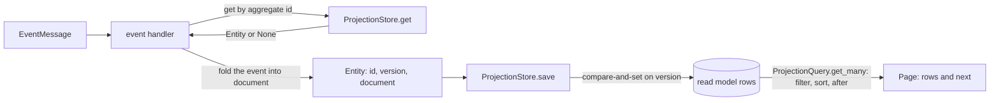
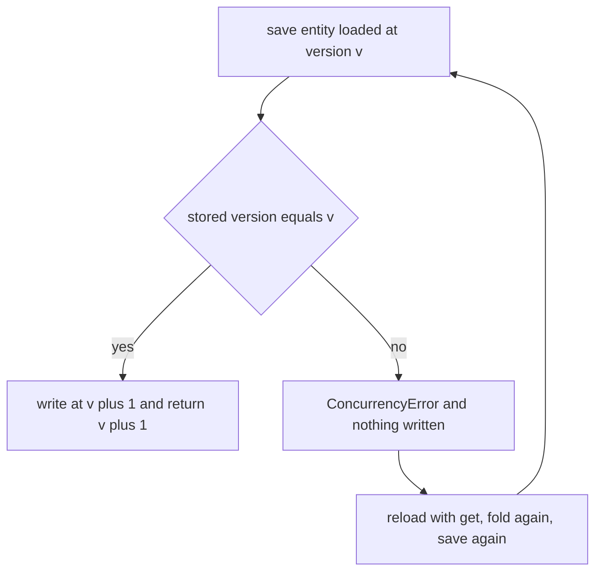
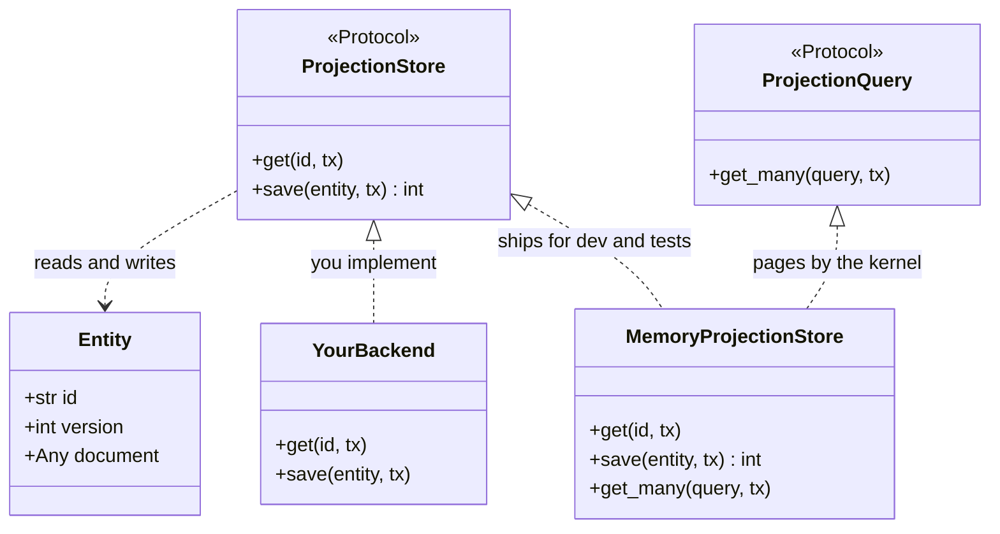
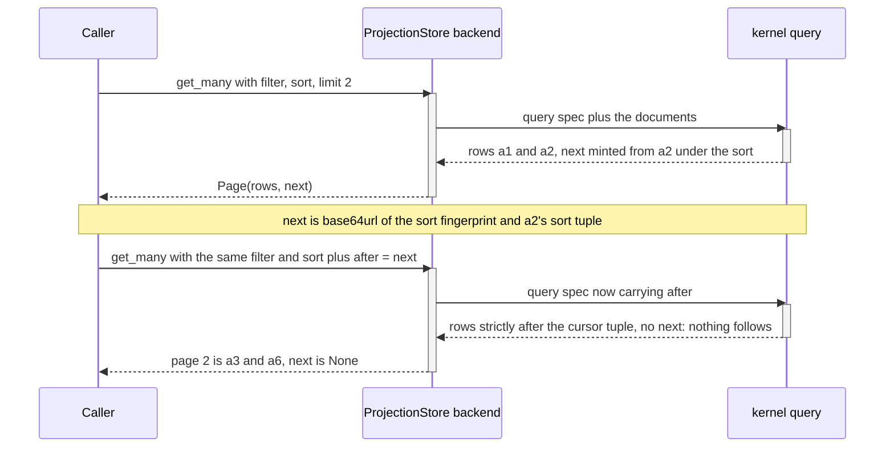

# Projections

The read side: a read model stored as one document per id, written with a version check, and paged
with semantics the kernel decides.

The event-sourced side replays events to rebuild an aggregate. A read model is the other shape: a
current document you save and query directly. `ProjectionStore` is that seam: a versioned document
store, one document per id under an optimistic version check. `ProjectionQuery` is its query side,
which a store implements beside it to page the documents by the kernel's rules. It is not a projector. It keeps no
record of which events a row has folded, so it cannot skip a redelivered one by itself. Deduplication
comes from the consume-path guard, [`idempotent_by_id`](./consuming.md#idempotent_by_id), in front of
the handler. A projector that folds events and keeps per-row marks is a deferred feature. No durable
store ships with edax; you bring one.

A redelivered event can reload the current row version, fold again, and pass the next version check.
Commit the consume guard and projection write in the same transaction to close that replay window.
If the host tracks source positions instead, commit those positions with the derived document.
Keep a position per source when a row combines aggregates or partitions; their sequence numbers are
not one shared order.

A successful dead-letter sink lets later events pass the failed event. If the projector advances a
source watermark, a late redrive can be rejected by `is_stale`. The store cannot repair that gap:
rebuild or reconcile the affected document, or stop consumption before acknowledging the failed event.
See [consuming](./consuming.md) for the ordering limits and Kafka's partition-wide rewind.



## `Entity`

Three fields, and the third carries the whole concurrency rule.

| Field | Python type | Rust type | Meaning |
|---|---|---|---|
| `id` | `str` | `String` | the row key, normally the aggregate id the projection tracks |
| `version` | `int` | `u64` | the version the entity was loaded at; `0` for one never saved |
| `document` | `Any` | `serde_json::Value` | the queryable body, a JSON object |

`version` is there because `save` is a compare-and-set, not an overwrite. The store writes at
`version + 1` only if the stored version still equals `version`. A writer that loaded version 1,
held it while another writer advanced the row to 2, and then saved, loses: it gets
`ConcurrencyError` and writes nothing. The stale writer's document never lands on top of the newer
one. An `Entity` is a value: on success `save` returns the new version and leaves the entity as it
was. Build the next one with that version, or reload with `get`.

The Rust software development kit (SDK) pins both halves of that rule. `save_versions_then_get`
asserts that the first save returns `1`. `stale_version_conflicts` asserts `Error::concurrency(1, 2)`
for the writer whose version is stale. Python's `ProjectionStoreContract` asserts the same.



## The `ProjectionStore` seam



Nothing in the SDK calls these ports. Only your handlers do. That is why the query side is a port of
its own: a store you never page through implements `ProjectionStore` alone. `get` and `save` are what
a projection handler needs.

| Method | Must guarantee |
|---|---|
| `get(id, tx=None)` | returns the current committed row plus the `tx`'s own staged writes, or `None`; the document carries the row key as `"id"` |
| `save(entity, tx=None)` | refuse a document that is not a JSON object with `CodecError`; then compare-and-set on `entity.version`; on success return the new version, on mismatch raise `ConcurrencyError` and write nothing |
| `ProjectionQuery.get_many(query, tx=None)` | refuse a spec `edax.query.check_query` refuses with `CodecError`; then return a `Page` (`rows`, `next`) paged by the kernel's filter / sort / keyset rules, each row carrying its row key as `"id"`, with `next` minted by `encode_cursor` and `after` read by `decode_cursor` |

*The document is an object.* A read carries each row's key in its `id` field, so a list or a scalar
could be saved and never found. Call `edax.projection.check_document(id, document)` before the
write: it is the kernel's rule (`edax_cqrs::document`), the one the memory stores apply, and it also
refuses an integer wider than 64 bits. `ProjectionStoreContract` holds a store to it.

*The row key is the `id`.* `get` and `get_many` return each document with its row key under `"id"`,
overwriting any `"id"` the saved document carries. Call `edax.projection.keyed_document(id, document)`
in `get`, or select the key into the document in your `get_many` query. It is the kernel's rule
(`edax_cqrs::keyed_document`), pinned by `testdata/golden/projection_document.json`.

Two points a backend author gets wrong first.

*Enforce the version check in the database, not in your process.* A read-then-write in Python is not
a compare-and-set; two processes will interleave. Use `UPDATE ... WHERE version = ?` and check the
affected row count, or a unique insert for version 1.

*Enlist in the caller's transaction.* Every method takes an optional `tx`. With `tx` given, or with
`current_tx` of its transactor set by an enclosing `transaction`, the store runs inside that
transaction; with neither, it auto-commits. That is what lets a projection write commit with the events that produced it. See
[transactions](./transactions.md).

### Rust and Python parity

| | Rust (`crates/edax/src/projection.rs`) | Python (`crates/edax-py/python/edax/projection.py`) |
|---|---|---|
| seam | `trait ProjectionStore` with associated `type Tx` | `Protocol ProjectionStore`, `tx` keyword argument |
| query side | `trait ProjectionQuery: ProjectionStore` | `Protocol ProjectionQuery`, `runtime_checkable`, beside `ProjectionStore` |
| query shape | `edax_cqrs::Query`, re-exported not re-declared | `edax.query.Query`, a frozen value that writes the spec |
| save | `save(tx, &entity) -> Result<u64, Error>` | `await save(entity, tx=None) -> int` |
| conflict | `Error::concurrency(expected, stored)`, code `concurrency` | `ConcurrencyError` |

Rust re-exports the kernel's `Query` rather than declaring its own, so the spec the SDK serializes
is by construction the one the kernel parses. Python mirrors it as the `Query` value. Its
`to_json()` is the one spec writer, shared by `edax.query.query` and every backend's `get_many`, so
the two cannot drift.

## Keeping a projection up to date

An event handler folds an event message into an `Entity`. This is the handler from
`examples/py/10_idempotent_events.py`, without the failure that example injects:

```python
@router.on("Deposited")
async def add_deposit(msg: EventMessage) -> None:
    row = await balances.get(msg.aggregate_id) or Entity(msg.aggregate_id, 0, {"balance": 0})
    deposit: Deposited = events.unmarshal(msg)  # the writer's codec: upcasts, refuses a newer writer
    balance = row.document["balance"] + deposit.amount
    await balances.save(replace(row, document={"balance": balance}))  # joins the guard's transaction
```

Read it in four steps. Load the entity by aggregate id. Seed version `0` when the row does not
exist, so the first `save` is an insert. Decode the payload with the writer's codec
([consuming](./consuming.md#decoding-the-payload)) and fold it into a new document. Save the new
entity at the loaded version, with no explicit `tx`, so the store picks up the ambient transaction the
guard opened.

That fold is `balance + amount`, which is not idempotent: a redelivered event applied twice
double-counts. The guard, `idempotent_by_id`, is what stops it, and what the guard is worth depends on
whether the claim and this `save` commit together. `examples/py/10_idempotent_events.py` shares one
unit of work and asserts each deposit counted once. `examples/py/19_fault_injection.py` puts the outer
guard's ledger in a database of its own. There a lost commit reply runs the handler twice, so a second
`idempotent_by_id`, whose ledger shares the read model's database, absorbs the rerun. See
[idempotency](./idempotency.md).

**Rebuilding by broker replay needs a fresh `scope`.** The guard keeps a record per event id under its
`scope`. Replay the topic into an emptied store under the same `scope`, and the guard skips every
event it has already seen, so the store stays empty. Rebuild under a new `scope`, such as
`"balances-v2"`, or clear that scope's records first.

## Querying

A query is independent parts applied in a fixed order: filter -> keyset(`after`) -> sort -> offset
-> limit.

### Filter

Build it with the constructors in `edax.filter`: `eq`, `ne`, `gt`, `gte`, `lt`, `lte`,
`starts_with`, `in_`, `contains`, `exists`, and the connectives `and_`, `or_`, `not_`. Each returns
a plain dict in the kernel's canonical form. [kernels/filter](../kernels/filter.md) covers the
abstract syntax tree and the null/missing rule, which is why `ne(p, x)` and `not_(eq(p, x))` differ.

`edax.filter.matches(filter, document)` evaluates one document in process, which is how you test a
filter without a store.

### Sort, offset, limit

`sort_key(path, desc=False, *, decimal=False)` builds one ordering key. `sort` is a list of them,
applied in order. Set `decimal=True` for a field that holds decimal values (`edax.Decimal` or `decimal.Decimal`). Their canonical text
then sorts by exact value, so `"9.5"` comes before `"10"`. Other strings in that field sort after
the decimals, by code point. An instant field (`edax.Instant` or `datetime`) needs no flag: the SDK writes it as fixed-width UTC
text, which sorts by instant.

The kernel fixes a total order across JSON types. The comparator never reports "incomparable", so a
sort is deterministic whatever value types the documents hold.

| Rank | Type | Order within the type |
|---|---|---|
| 0 | number | numerically, exactly. Integers above 2^53 do not collapse |
| 1 | string | by Unicode code point |
| 2 | bool | `false < true` |
| 3 | array | none: two arrays compare equal |
| 4 | object | none: two objects compare equal |
| 5 | null | none |

A missing path reads as `null` and therefore sorts last in ascending order. Numbers and strings
order through the filter comparator, so a sort and a range filter rank the same pair identically.
The mixed-type case in `testdata/golden/query.json` expects exactly this rank order.

Multi-key sort is stable and evaluated left to right. `Query` carries `filter`, `sort`, `offset`,
`limit` and `after`. Unset fields are omitted on the way out, so a backend reading the spec sees no
phantom clauses.

Three edges the test suite pins:

- `sort=[]` is no sort, exactly as omitting it.
- `limit=0` is an empty page, not an absent limit.
- `offset` past the end is an empty page, not an error.

### Keyset cursors

`offset` re-reads the prefix on every page and drifts when rows are inserted between calls. A keyset
cursor does not: it names the last row of the page, and the next page starts strictly after it.

`get_many` returns a `Page`: the `rows`, and `next`, the cursor the kernel minted from the last row
under the query's own sort. Pass `next` back as `after` with the same filter and sort. The caller
never restates the sort to build a cursor, so it cannot build one under the wrong sort. `next` is
`None` when no row follows the page, so a paging loop needs no extra empty page to learn it is done.
An unsorted query has no keyset to resume, so its `next` is always `None` and it pages by `offset`.

The cursor binds the sort it was minted under. It is
`base64url(canonical_json({"s": <fingerprint>, "v": [<values at the effective sort paths>]}))`,
unpadded so it survives a URL query string, and the fingerprint is the payload hash of the effective
sort. Replayed under another sort (another key, another direction, one key more) it is a terminal
`CodecError`, not a page of garbage. So is a cursor on an unsorted query. A row reaches the next page
only if its tuple sorts strictly after the cursor tuple; an equal tuple was the previous page's last
row.

The canonical form is RFC 8785, whose numbers are doubles. Say a page ends on a row whose sort value is
an integer outside -(2^53 - 1) to 2^53 - 1. Then it cannot mint `next`: the query fails with
`CodecError` rather than resume at the wrong row. Keep sort keys and ids that wide as strings. A
float sort value pages exactly at any size. RFC 8785 writes a whole float past 2^53 as an integer,
and the kernel reads an integer outside that range back as the float it was minted from.

A backend does not re-derive any of that. The kernel owns both halves of the round trip.
Read `after` with `decode_cursor`, which refuses a cursor minted under another sort, and mint `next`
with `encode_cursor`. Order by `effective_sort` rather than by the declared keys:

```python
from edax.query import decode_cursor, effective_sort, encode_cursor

keys = effective_sort(spec["sort"])  # the declared sort plus the `id` tiebreak
values = decode_cursor(spec["after"], spec["sort"])  # one value per key in `keys`, aligned
# bind `keys` into ORDER BY and `values` into the keyset comparison; fetch limit + 1 rows
# next = encode_cursor(rows[limit - 1], spec["sort"]) if more than `limit` came back, else None
```

All three are pinned by `testdata/golden/cursor.json` and `query.json`, which every binding's suite
reads. A backend that decodes differently fails a test instead of paging wrong in production.
`ProjectionStoreContract` holds a backend that is a `ProjectionQuery` to the same rules.
Every row arrives once while other writers insert or delete rows between pages. `next` is the
kernel's cursor. A cursor under another sort is refused.

That promise covers rows whose sort values hold still. A row whose sort value changes between pages
moves to the other side of the cursor. It then arrives twice, or not at all. Sort by `balance`
descending, read the first page, then let one deposit lift a row from the second page to the top: the
walk never sees it. The property tests state this premise.

The document must carry a unique `"id"` that is a string or a number. The kernel appends
`{"path": "id"}` as a final sort key unless your sort already ends there. No two rows then share a
full sort tuple, and a page boundary landing inside a tie neither drops nor repeats a row. A row
whose `id` is missing, `null`, an array or an object cannot mint a cursor: that is a `CodecError`.
Arrays and objects compare by type alone. Rows tied on every other key would tie on the tiebreak
too, and paging past them would drop the rest of the tie. An empty sort takes no tiebreak and no
cursor.

Every read carries the row key as `"id"` (`keyed_document`), so the tiebreak is the row key. That
value is authoritative and overwrites any `"id"` already in the document. A durable backend must do
the equivalent in `get` and in `get_many`.

### A strict spec

The kernel reads the spec strictly, so a mistake fails instead of returning a plausible wrong page.
Each of these is a terminal `CodecError`:

- an unknown field anywhere. Think `{"dsc": True}` in a sort key, `"limt"` in the spec, or a typo
  in a filter leaf;
- a `None` comparand in `eq`, `ne`, a range or `in_`. It can match nothing. Ask
  `exists(path, False)` for a missing or null path;
- a path with an empty segment (`""`, `"a."`, `"a..b"`). A path is dot-delimited object keys. A key
  containing `.` cannot be addressed. `tags.0` reads a key named `"0"`, never an array index;
- an integer wider than 64 bits, which would otherwise be compared as the nearest float.

### A paging loop

Built from `examples/py/11_projection_query.py`, which runs this loop and asserts
`["a1", "a2"]` then `["a3", "a6"]`: page 2 resumed past a tie on `balance`.

```python
from edax.filter import and_, eq, gte
from edax.query import Query, sort_key

only = and_(gte("balance", 100), eq("status", "active"))
order = [sort_key("balance", desc=True), sort_key("id")]  # richest first, id as the tiebreak

after = None
while True:
    page = await store.get_many(Query(filter=only, sort=order, limit=2, after=after))
    for doc in page.rows:
        ...  # handle the row
    if page.next is None:
        break
    after = page.next
```



### The kernel's verdict is the contract

A backend is expected to push the filter, sort and pagination down to native `WHERE` / `ORDER BY` /
`LIMIT` rather than fetch everything and filter in process. Translating is fine; disagreeing is not.
The kernel's `query_json` is the reference applier, and a backend that pages down in SQL should
assert against it. Two services then page the same read model identically, and a cursor generated by
one binding is understood byte-for-byte by another.

A backend may instead read the spec as its own query dialect. It is then no `ProjectionQuery`: its
cursors are not portable across services, and you own that.

`MemoryProjectionStore.get_many` defers to the kernel, which makes it the reference for how a
durable backend must behave.

### Query a list without a store

`edax.query.query(documents, query)` applies the same pipeline to a plain list in process, and
returns the same `Page`. Use it to test a `Query`, or to page a set you already hold.

## Errors

| Raised | When | Verdict |
|---|---|---|
| `ConcurrencyError` | `save` version mismatch, and nothing else | transient: reload and refold |
| `CodecError` | a malformed or misspelled filter or spec, a `None` comparand, a cursor minted under another sort, a `next` from a row without a string or number `id`; a document the backend cannot marshal, or one holding an integer wider than 64 bits | terminal |
| `StoreError` | anything else the backend fails on | transient |

A corrupt cursor tagged as a store failure would look transient, and the handler paging with it
would be redelivered forever. `test_get_many_rejects_a_bad_spec_as_terminal`
asserts `caught.value.terminal is True` for each refusal above.

A scalar or array document is rejected at `save`, not at the query. It has nowhere for a read to
carry the row key as `"id"`. Such a row could be written and then never paged. The memory adapter
raises `CodecError` while the caller can still fix it.

A document holding an integer wider than 64 bits is rejected at `save` too, and by `query`. The filter
and the sort would read it as the nearest float, and `get` would return it rounded. Store such a
value as a string.

See [errors](./errors.md).

## Stale reads

A projection is eventually consistent behind the write side. The write commits, the relay drains the
outbox afterwards, the broker delivers at-least-once, and the handler folds the event later still.
Every one of those steps is a gap where a query returns a document that does not yet reflect a
committed write. Say so in your application programming interface (API).

What a reader should do about it:

- **Do not decide a write from a projection read.** Load the aggregate through
  [`Repository`](./aggregates.md) and let its optimistic version reject the stale decision. A
  projection read cannot.
- **Do not promise read-your-writes** unless the projection `save` shares a unit of work with the
  write, as `examples/py/10_idempotent_events.py` does. Sharing a
  transactor is the only arrangement here that closes the gap.
- **Return the version.** `Entity.version` is monotonic per row, so a caller can tell an unchanged
  document from a refreshed one, and a client can refuse to go backwards.
- **Hold a cursor, not an offset, across pages.** A projection is being written while you page it;
  `offset` drifts under inserts, `after` does not. Neither holds a row whose sort value changes
  mid-walk: it is repeated or skipped. Sort a walk that must see every row once by a value the fold
  never changes, such as `id`.
- **Keep the fold safe under redelivery.** The store's compare-and-set protects the row, not your
  arithmetic. `balance + amount` applied twice is wrong however the version check went. Guard the
  handler; see [idempotency](./idempotency.md).

## See also

- [kernels/filter](../kernels/filter.md) — the filter abstract syntax tree and the null/missing
  rule.
- [kernels/cqrs](../kernels/cqrs.md) — the total order over JSON values and the cursor encoding.
- [sdk/aggregates](./aggregates.md) — the write side this read model trails.
- [sdk/transactions](./transactions.md) — how a projection write joins the events' unit of work.
- [sdk/idempotency](./idempotency.md) — what stops a redelivered event folding twice.
- [sdk/errors](./errors.md) — transient against terminal, and what branches on it.
- [backends/memory](../backends/memory.md) — `MemoryProjectionStore`, the reference implementation.
- [guides/examples](../guides/examples.md) — `11_projection_query.py` end to end.
