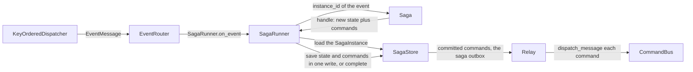
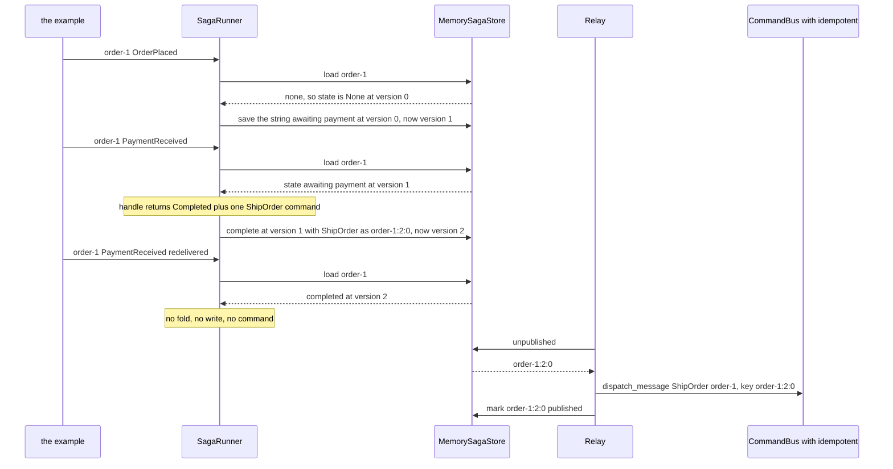

# Sagas

Cross-aggregate workflows: correlate a committed event to a running instance, fold it into that
instance's state, and emit the commands that drive the next step.

Where an aggregate decides one entity's next state, a saga coordinates a workflow spanning several.
This is the Saga pattern, used instead of a distributed transaction. There is no two-phase commit
across the aggregates involved. There is only a sequence of local transactions linked by
events and commands.

## The pieces

| Piece | Source | What it is |
|---|---|---|
| `Saga` | seam, `edax.saga`, `edax::saga` | the decision half: a `name`, then `instance_id` and `handle` |
| `SagaInstance` | `edax.saga`, `edax::saga` | one stored instance: its `state` and `version`, or a completed tombstone |
| `SagaStore` | seam, `edax.saga`, `edax::saga` | instance state keyed by instance id, with optimistic concurrency, plus the saga outbox |
| `CommandMessage` | `edax`, `edax::CommandMessage` | one outbox row: the command message the kernel's `saga_command` built |
| `SagaRunner` | `edax.saga`, `edax::saga` | the wiring: load, fold, persist state and commands in one write |
| `Relay` | `edax.store`, `edax::Relay` | sends the committed commands, the same relay that drains the event outbox |
| `Completed` | `edax.saga` | the Python sentinel a `handle` returns to finish the instance |

The runner is an ordinary event handler. Pass `SagaRunner.on_event` to an `EventRouter` or straight
to a `KeyOrderedDispatcher`. It takes a command codec, `json_codec({"Fulfill": Fulfill})`, to put the
commands in the outbox. `runner.relay(bus, on_dead=sink)` sends them through
`bus.dispatch_message` (`examples/py/13_saga.py`). Pass `on_dead`: without a sink, a command that
fails terminally is handed back on every drain, and the rows behind it wait. In Rust, the codec is a
`RegistryCodec` over the command enum, and `Relay::<_, CommandMessage>::new(store).on_dead(sink)`
with `runner.command(row)` sends them.

### The name

A saga declares a `name`, such as `name: ClassVar[str] = "order"`. Keep it stable across deploys. It
scopes the idempotency key of every command the saga sends. Two sagas may share an instance id and a
bus, and their commands still never meet under one key.

### The instance rule

`instance_id(msg)` answers one question: which running instance does this event belong to?

- A string names the instance. The runner loads it, or starts at `None` state and version `0` if
  there is none. A completed instance takes no event: the runner returns before it folds.
- `None` ignores the event. The runner returns before it touches the store, so an unrelated event
  costs nothing and writes nothing.

The instance id is the saga's own key, not the aggregate id: one instance spans several
aggregates. It is often derived from the aggregate id, as in `examples/py/13_saga.py`, and that
choice has a concurrency consequence, below. Every command the instance sends carries it as
`aggregate_id`, so one instance's commands keep their order on every transport.

It is also not the event's `correlation_id`. That one names a logical flow and travels with every
message; this one names a stored saga instance. One flow may drive several instances, and no code
reads one to produce the other. The next section covers the flow.

### handle

`handle(state, msg)` returns `(new_state, commands)`. `state` is `None` for a new instance.

| To do this | Python returns | Rust returns |
|---|---|---|
| keep the instance | `(new_state, commands)` | `(Some(state), commands)` |
| finish the instance (a tombstone) | `(Completed, commands)` | `(None, commands)` |
| keep a state that happens to be null | `(None, commands)` | not expressible: `None` means completed |

This is the one seam where the two software development kits (SDKs) differ. Python needs
the `Completed` sentinel because `None` is a legitimate state a saga may keep, and a plain `None`
return would be indistinguishable from completion. The `none_state_is_saved_not_completed` case of
`test_saga.py::test_runner_branches` pins it. The sentinel is an enum member, so its identity
survives `copy`, `deepcopy` and `pickle`. A saga's state may travel through a snapshot. `new_state
is Completed` must still hold afterwards.

### The lineage across the hop

A saga is where a flow would otherwise break: `handle` returns command objects, not messages. The
kernel closes the gap. `saga_command` builds each outbox row as a `CommandMessage` that is a child of
the folded event. [edax-event](../kernels/event.md#saga--the-write-a-saga-step-makes) lists each
field and why. Two inputs come from the runner. The idempotency key scopes the id under the saga's
`name`. `issued_at` is the runner's clock, `now=` (default: the kernel clock).

The command stays a pure business intent: it needs no lineage fields.

The relay hands each row to `bus.dispatch_message(row, codec)`. The row keeps its id and lineage, so
the events its handler saves continue the flow ([lineage rules](../kernels/event.md#causation--lineage)).
The chain reads request, event, saga command, event, and nothing in it was stamped by hand. `testdata/golden/saga.json` pins the row, so both SDKs write
the same one.

### SagaStore

| Method | Contract |
|---|---|
| `load(id, tx)` | the stored `SagaInstance` (state, version and `folded` marks, or a completed tombstone) or `None` |
| `save(id, state, version, folded, commands, tx)` | write the state, the `folded` marks and the step's commands at `version + 1` only if the store is still at `version`, else raise `ConcurrencyError` and write nothing; returns the new version |
| `complete(id, version, commands, tx)` | the same, writing a tombstone instead of state |
| `unpublished(limit)` / `mark_published(ids)` | the saga outbox, read by the relay outside any `tx`: committed commands only, oldest first, pruned by id, idempotently |
| `tx` | with `tx` given, or `current_tx` of the store's transactor set, a durable backend enlists the write in that unit of work |

A completed instance takes no write at all. Each command carries the id
`saga_command_id(id, version + 1, index)`, which is `"{instance_id}:{version}:{index}"`. It is
unique per committed transition. A durable store can key the outbox row on it. The command's
idempotency key is that id under the saga's name, so a consumer deduplicates on it. The in-memory
backend refuses a command whose id is not that one, as `codec`. A
durable store purges tombstones by retention, longer than any redelivery window. `SagaStoreContract` in
`edax.testing` (and `crates/edax/tests/contract.rs` in Rust) holds a backend to every clause.

`folded` is the kernel's record of the events the instance has folded (`saga_admit`). It is opaque
text: the store keeps it in a text column, as `save` wrote it, and `load` returns it. It
holds one entry per source aggregate: the highest sequence and the last event id folded from it. So
it grows with the aggregates a workflow touches, not with its events. Before it folds, the runner
asks the kernel whether the instance has folded the event already. A repeat is skipped: no fold, no
write, no command. So a redelivered step never decides its commands a second time under the next
version's ids. The rule relies on the dispatcher handing one aggregate's events over in
order, as the staleness rule does. An unsequenced event has no order, so only the last one folded from
its aggregate is recognized.

## Optimistic concurrency

The runner writes at the version it loaded, not at a re-read. A writer that lands between the
load and the write makes this write a conflict, never a silent overwrite.

A `ConcurrencyError` from a saga store therefore means one thing. Another writer advanced this
instance while this event was being handled. This event's fold is based on state that is now stale,
and so are the commands it decided. Both roll back with the write: nothing this fold decided is ever
sent. The error is transient, so the event is redelivered and folds the fresh state. The racing
writer's state and commands survive untouched.

**When can that happen?** The `KeyOrderedDispatcher` serializes events that share an aggregate id. A
saga whose `instance_id` is the aggregate id therefore has no concurrent writer. Its version check
never fires. The version exists for a cross-aggregate instance, where two different aggregate ids
map to one instance id and therefore to two different workers. `Paid` from the
payment aggregate and `Cancelled` from the order aggregate can fold one order at once.
`test_saga.py::test_the_fold_that_loses_the_version_race_sends_nothing` pins it: the cancel commits a
`Refund` first, the payment's write conflicts, and its `Fulfill` never goes out. So does
`the_fold_that_loses_the_version_race_sends_nothing` in the Rust suite.

## The saga outbox: persist, then send

The runner never sends a command. It writes the new state and the commands the fold decided in one
versioned write, and a `Relay` sends what committed. This is the transactional outbox applied to a
saga: the decision and the messages it produces are stored in one transaction.

| Failure point | Instance after | What happens |
|---|---|---|
| the write conflicts | the winner's | nothing of this fold is sent; the redelivery folds the winner's state |
| the write fails, or the unit of work rolls back | unchanged | nothing to send; the redelivery decides again |
| the write lands, then the response is lost | advanced | the redelivery finds the event in the instance's `folded` marks (or the tombstone) and skips it |
| the step commits, then the ack is lost, or a crash replays every event above the committed offset | advanced | each redelivered event the instance folded is skipped: its command was committed once and is sent once |
| crash after the commit, before the relay sends | advanced | the command waits in the outbox; the next drain sends it |
| crash after the relay sent, before it marked | advanced | the next drain sends it again; the consumer deduplicates by the idempotency key, the command id under the saga's name |
| a command fails terminally in the relay | advanced | with `on_dead` wired, the relay dead-letters the row through it and the rows behind it go out; without it, the row is handed back on every drain and blocks the rows behind it |

So a command is sent at least once per committed step, and never for a step that did not commit.
The row's `idempotency_key` is stable across re-sends, so an `idempotent` guard on the bus replays a
re-sent row instead of running its handler twice. `test_saga.py::test_the_saga_outbox_sends_each_committed_command_once_and_nothing_else`
(hypothesis) and `crates/edax/tests/saga_model.rs` (proptest) check it over random histories of two
workers with stale reads, crashed commits, failed publishes, lost marks and redeliveries of committed
events.

## One instance, end to end

```mermaid
stateDiagram-v2
    [*] --> ignored : instance_id returned None
    ignored --> [*]
    [*] --> open : first event of the instance, state was None, version 0
    open --> open : an event folds into state, saved with its commands at version plus one
    open --> conflicted : a racing writer advanced the version first
    conflicted --> open : the write rolled back with its commands; the event is redelivered
    open --> completed : handle returned Completed; tombstone and commands written at version plus one
    open --> open : an event the instance folded already is redelivered and skipped
    completed --> completed : a redelivered or late event finds the tombstone and is not folded
```

## The example, step by step

`examples/py/13_saga.py` runs an order saga. `OrderPlaced` opens an instance, and `PaymentReceived`
emits `ShipOrder` and completes it. The example hands `PaymentReceived` over twice. It calls
`runner.on_event` directly, so there is no broker settlement: the redelivery is the same event
message handed over again.

The redelivery is absorbed by the tombstone, before any fold. The bus's `idempotent` guard absorbs
the relay's own re-sends after a lost mark. See [idempotency.md](./idempotency.md).

## Rust and Python

| | Rust | Python |
|---|---|---|
| Completion | `handle` returns `None` for the state | `handle` returns the `Completed` sentinel |
| Transaction | `run(tx, msg)` takes the handle explicitly | `on_event(msg, tx=None)` falls back to `current_tx` |
| Commands | `SagaRunner::new(saga, store, codec)`, the codec a `RegistryCodec` over the command enum | `SagaRunner(saga, store, codec)`, the codec a `json_codec` over the command types |
| Sending | `Relay::<_, CommandMessage>::new(store)` and `runner.command(row)` | `runner.relay(bus)`, through `bus.dispatch_message` |
| State type | `Saga::State` and `SagaStore::State`, statically typed | `Any`, serialized as JSON by the in-memory backend |

Both runners ask the kernel whether a step folds at all (`edax_event::saga_admit`) and which write it
makes (`edax_event::saga_write`), pinned by `testdata/golden/saga.json`. A completed instance folds
nothing. When nothing was loaded and the fold neither keeps state nor sends a command, the write is
`nothing`. Otherwise it is `save` or `complete` at the loaded version. A versioned write for the
`nothing` case would turn a no-op into a write that a concurrent creator of the same instance
could conflict with.

An explicit `tx` wins over the ambient one in Python, pinned by the `explicit_tx_wins_over_ambient`
and `ambient_tx_is_joined` cases.

## Compensation

The SDK provides no compensation machinery. There is no `compensate` hook, no reverse-order
rollback, and no failure-branch bookkeeping in `SagaRunner`, whose whole body is load, fold,
persist.

| Concern | Who owns it |
|---|---|
| Detecting that a step failed | the host: the saga observes the failure event and folds it |
| Deciding what undoes a step | the host: `handle` returns the compensating command like any other |
| Delivering the compensating command | the SDK: the saga outbox and the `Relay`, then the `CommandBus`, with `idempotent` to absorb re-sends |
| Not repeating a compensation | the SDK: the guard on the bus, keyed by the row's idempotency key |
| Keeping the workflow's own state | the SDK: `SagaStore`, with optimistic concurrency on the version and a tombstone on completion |

So a compensating action in edax is an ordinary command, emitted by an ordinary `handle` branch, in
response to an ordinary event.

## See also

- [consuming.md](./consuming.md) — the `KeyOrderedDispatcher` and `EventRouter` that feed the
  runner.
- [idempotency.md](./idempotency.md) — the guard that absorbs the relay's re-sent commands.
- [outbox.md](./outbox.md) — the `Relay`, its poison-row policy and its backoff.
- [commands.md](./commands.md) — the `CommandBus` a saga dispatches into.
- [aggregates.md](./aggregates.md) — the other side of the divide, one entity's own decisions.
- [transactions.md](./transactions.md) — how a saga state write joins the events' unit of work.
- [../backends/memory.md](../backends/memory.md) — `MemorySagaStore` and what it does not survive.
