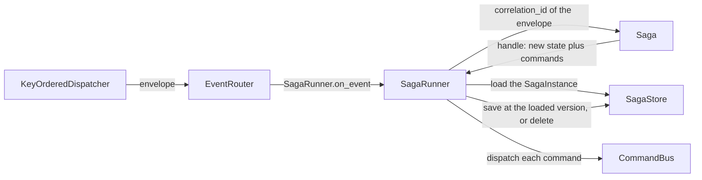
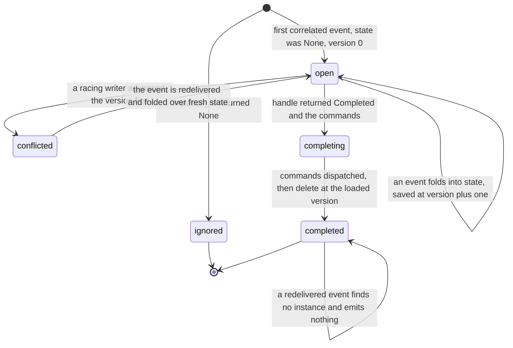
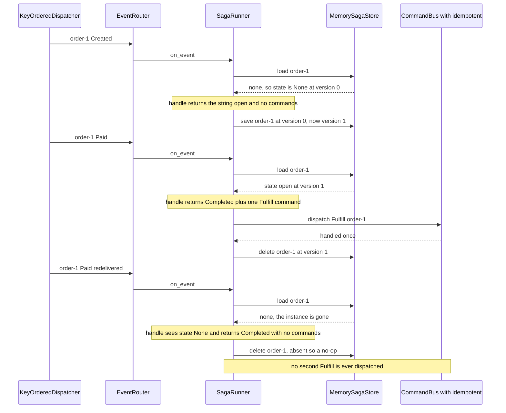

# Sagas

Cross-aggregate workflows: correlate a committed event to a running instance, fold it into that
instance's state, and emit the commands that drive the next step.

Where an aggregate decides one entity's next state, a saga coordinates a workflow spanning several.
This is the Saga pattern, used **instead of a distributed transaction**. There is no two-phase
commit across the aggregates involved. There is only a sequence of local transactions linked by
events and commands.

## The pieces

| Piece | Source | What it is |
|---|---|---|
| `Saga` | seam, `edax.saga`, `edax::saga` | the decision half: `correlation_id` then `handle` |
| `SagaInstance` | `edax.saga`, `edax::saga` | one running instance: its `state` and the `version` it was loaded at |
| `SagaStore` | seam, `edax.saga`, `edax::saga` | where instance state lives, keyed by correlation id, with optimistic concurrency |
| `SagaRunner` | `edax.saga`, `edax::saga` | the wiring: load, fold, dispatch, persist |
| `Completed` | `edax.saga` | the Python sentinel a `handle` returns to finish and remove the instance |

The runner is an ordinary event handler. Pass `SagaRunner.on_event` to an `EventRouter` or straight
to a `KeyOrderedDispatcher`, and `CommandBus.dispatch` as its `dispatch` (`examples/py/saga.py:80`).

### The correlation rule

`correlation_id(env)` answers one question: which running instance does this event belong to?

- A **string** names the instance. The runner loads it, or starts at `None` state and version `0` if
  there is none.
- **`None` ignores the event.** The runner returns before it touches the store, so an unrelated
  event costs nothing and writes nothing.

The correlation id is the saga's own key, not the aggregate id — that is the whole point of a saga.
It is often *derived* from the aggregate id, as in `examples/py/saga.py:41`, and that choice has a
concurrency consequence, below.

### handle

`handle(state, env)` returns `(new_state, commands)`. `state` is `None` for a new instance.

| To do this | Python returns | Rust returns |
|---|---|---|
| keep the instance | `(new_state, commands)` | `(Some(state), commands)` |
| finish and remove the instance | `(Completed, commands)` | `(None, commands)` |
| keep a state that happens to be null | `(None, commands)` | not expressible — `None` means completed |

That is the one seam where the two software development kits (SDKs) genuinely differ. Python needs
the `Completed` sentinel because `None` is a legitimate state a saga may keep, and a plain `None`
return would be indistinguishable from completion. The `none_state_is_saved_not_completed` case of
`test_saga.py::test_runner_branches` pins it. The sentinel is an enum member, so its identity
survives `copy`, `deepcopy` and `pickle`. A saga's state may travel through a snapshot. `new_state
is Completed` must still hold afterwards.

### SagaStore

| Method | Contract |
|---|---|
| `load(id, tx)` | the stored `SagaInstance` — state plus version — or `None` |
| `save(id, state, version, tx)` | persist at `version + 1` **only if** the store is still at `version`, else raise `ConcurrencyError`; returns the new version |
| `delete(id, version, tx)` | remove at `version`; a stale version conflicts, an **absent instance is a no-op at any version** |
| `tx` | with `tx` given, or `current_tx` set, a durable backend enlists the write in that unit of work |

The idempotent delete is not an accident. A redelivered completion after a lost response must
converge rather than fail, so the rule is written once in the shared adapter and every SDK meets the
same referee. The in-memory backend stages a write under an open token until the transactor commits,
and conflicts against an id another open transaction has written and not yet committed. It is not
durable; a production backend enlists the state write in the events' transaction.

## Optimistic concurrency

The runner persists at the version it **loaded**, not at a re-read. A writer that lands between the
load and the persist makes the completion a conflict, never a silent overwrite.

A `ConcurrencyError` from a saga store therefore means one thing. Another writer advanced this
instance while this event was being handled. This event's fold is based on state that is now stale.
Redeliver the event and fold it again over the fresh state. The racing writer's state survives
untouched.

**When can that happen?** The `KeyOrderedDispatcher` serializes events that share an aggregate id. A
saga whose `correlation_id` is the aggregate id therefore has no concurrent writer. Its version
check never fires. The version exists for a **cross-aggregate** correlation, where two different
aggregate ids map to one correlation id and therefore to two different workers.
`test_saga.py::test_saga_version_advances_and_stale_write_conflicts` pins it. So does
`saga_write_at_loaded_version_catches_a_racing_writer` in the Rust suite.

The version is optimistic concurrency on the instance only. It does **not** make dispatch and
persist atomic — see the next section.

## Dispatch first, then persist

The runner dispatches the emitted commands **before** it saves state. A crash in between re-emits
them on redelivery, so a saga's command stream is at-least-once, and the command bus's `idempotent`
guard is what absorbs the duplicates. Making the pair atomic would need a saga outbox, which the SDK
does not provide.

| Failure point | Instance after | Redelivery does |
|---|---|---|
| `dispatch` raises | unchanged, still open | re-emits the command; the bus deduplicates it |
| `save` or `delete` raises | unchanged, still open | folds the same state again, re-emits the command |
| `save` lands, then the response is lost | advanced | loads the *new* state, folds again, saves at the next version — no rewind |
| `delete` lands, then the response is lost | gone | finds no instance, emits nothing, deletes a no-op |

The lost-response rows are the interesting ones: the write landed but the caller saw a `StoreError`.
Because the redelivery re-reads, it folds the already-advanced state rather than replaying the old
step. `test_saga.py::test_saga_partial_failure_redelivers_at_least_once` pins the ordinary-failure
rows. The Rust saga suite pins the same rows.

## One instance, end to end

## The example, step by step

`examples/py/saga.py` runs an order saga: `Created` opens an instance, `Paid` emits `Fulfill` and
completes. The stream contains a redelivered `Paid` for `order-1` (`examples/py/saga.py:62`). The
example submits bare envelopes, so there is no broker settlement — the redelivery is the same
envelope submitted twice.

**Which mechanism tolerates the redelivery.** Two, at different windows, and the example exercises
the first:

1. *The completion already landed.* The instance is gone, so `handle` takes its no-live-instance
   branch and returns no command (`examples/py/saga.py:48`), and the store's delete of an absent
   instance is a no-op. The command bus is never reached.
2. *The completion had not landed yet* — a crash between dispatch and persist. The instance is still
   open, `handle` emits `Fulfill` a second time, and the bus's `idempotent` guard keyed on
   `fulfill:{order_id}` deduplicates it (`examples/py/saga.py:73`). This is the window the "dispatch
   first, then persist" ordering deliberately leaves open.

Mechanism 1 is the saga's own logic, which every host writes. Mechanism 2 is the guard, and it is
why `SagaRunner.dispatch` should be a bus that carries `idempotent`. See
[idempotency.md](./idempotency.md).

## Rust and Python

| | Rust | Python |
|---|---|---|
| Completion | `handle` returns `None` for the state | `handle` returns the `Completed` sentinel |
| Transaction | `run(tx, env, dispatch)` takes the handle explicitly | `on_event(env, tx=None)` falls back to `current_tx` |
| Dispatch | an `FnMut(&Command) -> Result<(), Error>` closure argument | a `dispatch` callable given to the constructor, sync or async |
| State type | `Saga::State` and `SagaStore::State`, statically typed | `Any`, serialized as JSON by the in-memory backend |
| Nothing loaded, nothing produced | writes nothing at all | still calls `delete`, which the store treats as a no-op |

That last row is a real difference. Rust skips the delete when no instance was loaded. A versioned
delete would turn a no-op into a write. A concurrent creator of the same correlation could then
conflict with it. Python always calls `delete`, so it relies on the store's absent-is-a-no-op rule
instead. The observable outcome matches for any store that honors the `SagaStore` contract.

An explicit `tx` wins over the ambient one in Python, pinned by the `explicit_tx_wins_over_ambient`
and `ambient_tx_is_joined` cases.

## Compensation

**The SDK provides no compensation machinery.** There is no `compensate` hook, no reverse-order
rollback, no failure-branch bookkeeping in `SagaRunner` — its whole body is load, fold, dispatch,
persist.

| Concern | Who owns it |
|---|---|
| Detecting that a step failed | the host: the saga observes the failure event and folds it |
| Deciding what undoes a step | the host: `handle` returns the compensating command like any other |
| Delivering the compensating command | the SDK: the `CommandBus`, with `idempotent` to absorb duplicates |
| Not repeating a compensation | the SDK: the guard on the bus, keyed by the host |
| Keeping the workflow's own state | the SDK: `SagaStore`, with optimistic concurrency on the version |

So a compensating action in edax is an ordinary command, emitted by an ordinary `handle` branch, in
response to an ordinary event.

## See also

- [consuming.md](./consuming.md) — the `KeyOrderedDispatcher` and `EventRouter` that feed the
  runner.
- [idempotency.md](./idempotency.md) — the guard that absorbs a saga's duplicate commands.
- [commands.md](./commands.md) — the `CommandBus` a saga dispatches into.
- [aggregates.md](./aggregates.md) — the other side of the divide, one entity's own decisions.
- [transactions.md](./transactions.md) — how a saga state write joins the events' unit of work.
- [../backends/memory.md](../backends/memory.md) — `MemorySagaStore` and what it does not survive.
