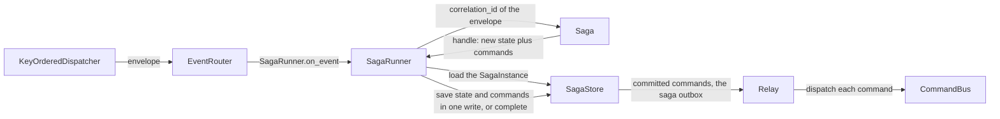
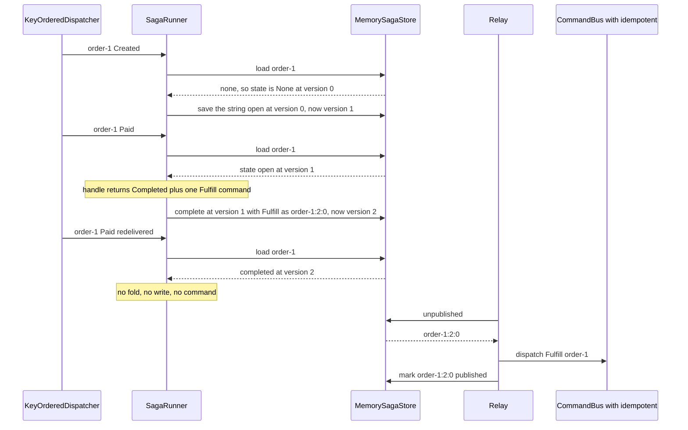

# Sagas

Cross-aggregate workflows: correlate a committed event to a running instance, fold it into that
instance's state, and emit the commands that drive the next step.

Where an aggregate decides one entity's next state, a saga coordinates a workflow spanning several.
This is the Saga pattern, used **instead of a distributed transaction**. There is no two-phase
commit across the aggregates involved. There is only a sequence of local transactions linked by
events and commands.



## The pieces

| Piece | Source | What it is |
|---|---|---|
| `Saga` | seam, `edax.saga`, `edax::saga` | the decision half: `correlation_id` then `handle` |
| `SagaInstance` | `edax.saga`, `edax::saga` | one stored instance: its `state` and `version`, or a completed tombstone |
| `SagaStore` | seam, `edax.saga`, `edax::saga` | instance state keyed by correlation id, with optimistic concurrency, plus the saga outbox |
| `SagaCommand` | `edax.saga`, `edax::SagaCommand` | one outbox row: the kernel's command id, the correlation, the marshaled command, a timestamp |
| `SagaRunner` | `edax.saga`, `edax::saga` | the wiring: load, fold, persist state and commands in one write |
| `Relay` | `edax.store`, `edax::Relay` | sends the committed commands, the same relay that drains the event outbox |
| `Completed` | `edax.saga` | the Python sentinel a `handle` returns to finish the instance |

The runner is an ordinary event handler. Pass `SagaRunner.on_event` to an `EventRouter` or straight
to a `KeyOrderedDispatcher`. It takes a command codec, `json_codec({"Fulfill": Fulfill})`, to put the
commands in the outbox. `runner.relay(bus.dispatch)` sends them (`examples/py/saga.py`). In Rust, the
codec is a `RegistryCodec` over the command enum, and `Relay::<_, SagaCommand>::new(store)` with
`runner.command(row)` sends them.

### The correlation rule

`correlation_id(env)` answers one question: which running instance does this event belong to?

- A **string** names the instance. The runner loads it, or starts at `None` state and version `0` if
  there is none. A completed instance takes no event: the runner returns before it folds.
- **`None` ignores the event.** The runner returns before it touches the store, so an unrelated
  event costs nothing and writes nothing.

The correlation id is the saga's own key, not the aggregate id — that is the whole point of a saga.
It is often *derived* from the aggregate id, as in `examples/py/saga.py:50`, and that choice has a
concurrency consequence, below.

It is also **not** the `correlation_id` in the envelope's metadata. That one names a logical flow
and travels with the events; this one names a stored saga instance. They share a word and nothing
else — no code reads one to produce the other. The chain in metadata is the next section.

### handle

`handle(state, env)` returns `(new_state, commands)`. `state` is `None` for a new instance.

| To do this | Python returns | Rust returns |
|---|---|---|
| keep the instance | `(new_state, commands)` | `(Some(state), commands)` |
| finish the instance (a tombstone) | `(Completed, commands)` | `(None, commands)` |
| keep a state that happens to be null | `(None, commands)` | not expressible — `None` means completed |

That is the one seam where the two software development kits (SDKs) genuinely differ. Python needs
the `Completed` sentinel because `None` is a legitimate state a saga may keep, and a plain `None`
return would be indistinguishable from completion. The `none_state_is_saved_not_completed` case of
`test_saga.py::test_runner_branches` pins it. The sentinel is an enum member, so its identity
survives `copy`, `deepcopy` and `pickle`. A saga's state may travel through a snapshot. `new_state
is Completed` must still hold afterwards.

### Carrying the chain across the hop

A saga is where a causation chain would otherwise break. `handle` returns commands, not metadata, so
the `correlation_id` and `causation_id` on `env` reach the emitted command only if you put them
there. Two ways, both sound.

**As command fields.** The default: explicit, and it survives a queue.

```python
@dataclass
class Fulfill:
    order_id: str
    correlation_id: str  # the flow this intent belongs to
    causation_id: str  # the id of the event that caused it
    type: ClassVar[str] = "Fulfill"


def handle(self, state: Any, env: edax.EventEnvelope) -> tuple[Any, list]:
    chain = propagate(env.metadata, env.id)  # returns exactly the two keys
    return Completed, [Fulfill(env.aggregate_id, **chain)]
```

The handler then stamps what it was handed onto the events it writes:
`await repo.save(order, metadata={"correlation_id": c.correlation_id, "causation_id": c.causation_id})`.

This does not break idempotency. A command field must be the same on every legitimate retry of one
intent, the rule in
[observability](./observability.md#traces-via-metadata-and-where-request-scoped-values-go). The
causing event is exactly that. A redelivery hands the saga the *same* envelope, same `id` and same
metadata, from the outbox and from the broker alike. The hash is unchanged, so the retry replays
instead of raising `PayloadMismatch`.

The real hazard is identity, not hashing. Chain ids in fields widen what the command **is**. Say two
different events can legitimately cause one intent. They now build two different commands. A key
that ignores the cause makes the second one a `PayloadMismatch` under the first one's record. So key
on the cause too, or keep the cause out of the command. `examples/py/saga.py` keys on `order_id`
alone, because exactly one event type causes `Fulfill`.

**Or through a middleware seam.** Keep the command a pure business intent and carry `env` beside it.
An event middleware wraps `SagaRunner.on_event` and puts the envelope where the command handler can
read it. Python has the `contextvar` precedent of `current_tx`. Rust can use a thread-local, because
the bus dispatch runs synchronously on the worker thread. The handler then calls `propagate` itself.
With the saga outbox the command runs later, in the relay, so this seam carries the chain only if the
command row does: prefer the command fields.

Nothing stamps the chain for you at either end. `Repository.save` copies the metadata you pass and
never calls `originate`, so a root event with no `ensure_ids()` has no chain at all.

### SagaStore

| Method | Contract |
|---|---|
| `load(id, tx)` | the stored `SagaInstance` (state plus version, or a completed tombstone) or `None` |
| `save(id, state, version, commands, tx)` | write the state **and** the step's commands at `version + 1` **only if** the store is still at `version`, else raise `ConcurrencyError` and write nothing; returns the new version |
| `complete(id, version, commands, tx)` | the same, writing a tombstone instead of state |
| `unpublished(limit)` / `mark_published(ids)` | the saga outbox, read by the relay outside any `tx`: committed commands only, oldest first, pruned by id, idempotently |
| `tx` | with `tx` given, or `current_tx` of the store's transactor set, a durable backend enlists the write in that unit of work |

A completed instance takes no write at all. Each command carries the id
`saga_command_id(id, version + 1, index)`, which is `"{correlation_id}:{version}:{index}"`. It is
unique per committed transition. A durable store can key the outbox row on it, and a consumer can
deduplicate on it. The in-memory backend refuses a command whose id is not that one, as `codec`. A durable store
purges tombstones by retention, longer than any redelivery window. `SagaStoreContract` in
`edax.testing` (and `crates/edax/tests/contract.rs` in Rust) holds a backend to every clause.

## Optimistic concurrency

The runner writes at the version it **loaded**, not at a re-read. A writer that lands between the
load and the write makes this write a conflict, never a silent overwrite.

A `ConcurrencyError` from a saga store therefore means one thing. Another writer advanced this
instance while this event was being handled. This event's fold is based on state that is now stale,
and so are the commands it decided. Both roll back with the write: nothing this fold decided is ever
sent. The error is transient, so the event is redelivered and folds the fresh state. The racing
writer's state and commands survive untouched.

**When can that happen?** The `KeyOrderedDispatcher` serializes events that share an aggregate id. A
saga whose `correlation_id` is the aggregate id therefore has no concurrent writer. Its version
check never fires. The version exists for a **cross-aggregate** correlation, where two different
aggregate ids map to one correlation id and therefore to two different workers. `Paid` from the
payment aggregate and `Cancelled` from the order aggregate can fold one order at once.
`test_saga.py::test_the_fold_that_loses_the_version_race_sends_nothing` pins it: the cancel commits a
`Refund` first, the payment's write conflicts, and its `Fulfill` never goes out. So does
`the_fold_that_loses_the_version_race_sends_nothing` in the Rust suite.

## The saga outbox: persist, then send

The runner never sends a command. It writes the new state and the commands the fold decided in one
versioned write, and a `Relay` sends what committed. That is the transactional outbox applied to a
saga: storing the decision and the messages it produces happen in one transaction.

| Failure point | Instance after | What happens |
|---|---|---|
| the write conflicts | the winner's | nothing of this fold is sent; the redelivery folds the winner's state |
| the write fails, or the unit of work rolls back | unchanged | nothing to send; the redelivery decides again |
| the write lands, then the response is lost | advanced | the redelivery reads the new state (or the tombstone) and does not repeat the step |
| crash after the commit, before the relay sends | advanced | the command waits in the outbox; the next drain sends it |
| crash after the relay sent, before it marked | advanced | the next drain sends it again; the consumer deduplicates by command id |
| a command fails terminally in the relay | advanced | the relay dead-letters the row through `on_dead`, and the rows behind it go out |

So a command is sent **at least once per committed step**, and never for a step that did not commit.
Key the command's idempotency guard on something stable across re-sends: the command's own identity,
or the row id. `test_saga.py::test_the_saga_outbox_sends_each_committed_command_once_and_nothing_else`
(hypothesis) and `crates/edax/tests/saga_model.rs` (proptest) check it over random histories of two
workers with stale reads, crashed commits, failed publishes and lost marks.

## One instance, end to end

```mermaid
stateDiagram-v2
    [*] --> ignored : correlation_id returned None
    ignored --> [*]
    [*] --> open : first correlated event, state was None, version 0
    open --> open : an event folds into state, saved with its commands at version plus one
    open --> conflicted : a racing writer advanced the version first
    conflicted --> open : the write rolled back with its commands; the event is redelivered
    open --> completed : handle returned Completed; tombstone and commands written at version plus one
    completed --> completed : a redelivered or late event finds the tombstone and is not folded
```



## The example, step by step

`examples/py/saga.py` runs an order saga: `Created` opens an instance, `Paid` emits `Fulfill` and
completes. The stream contains a redelivered `Paid` for `order-1`. The example submits bare
envelopes, so there is no broker settlement — the redelivery is the same envelope submitted twice.



The redelivery is absorbed by the tombstone, before any fold. The bus's `idempotent` guard absorbs
the relay's own re-sends after a lost mark. See [idempotency.md](./idempotency.md).

## Rust and Python

| | Rust | Python |
|---|---|---|
| Completion | `handle` returns `None` for the state | `handle` returns the `Completed` sentinel |
| Transaction | `run(tx, env)` takes the handle explicitly | `on_event(env, tx=None)` falls back to `current_tx` |
| Commands | `SagaRunner::new(saga, store, codec)`, the codec a `RegistryCodec` over the command enum | `SagaRunner(saga, store, codec)`, the codec a `json_codec` over the command types |
| Sending | `Relay::<_, SagaCommand>::new(store)` and `runner.command(row)` | `runner.relay(dispatch)` |
| State type | `Saga::State` and `SagaStore::State`, statically typed | `Any`, serialized as JSON by the in-memory backend |

Both runners ask the kernel which write a step makes (`edax_event::saga_write`, pinned by
`testdata/golden/saga.json`). A completed instance gets `ignore`. When nothing was loaded and the fold
neither keeps state nor sends a command, the write is `nothing`. Otherwise it is `save` or `complete`
at the loaded version. A versioned write for the `nothing` case would turn a no-op into a write a concurrent
creator of the same correlation could conflict with.

An explicit `tx` wins over the ambient one in Python, pinned by the `explicit_tx_wins_over_ambient`
and `ambient_tx_is_joined` cases.

## Compensation

**The SDK provides no compensation machinery.** There is no `compensate` hook, no reverse-order
rollback, no failure-branch bookkeeping in `SagaRunner` — its whole body is load, fold, persist.

| Concern | Who owns it |
|---|---|
| Detecting that a step failed | the host: the saga observes the failure event and folds it |
| Deciding what undoes a step | the host: `handle` returns the compensating command like any other |
| Delivering the compensating command | the SDK: the saga outbox and the `Relay`, then the `CommandBus`, with `idempotent` to absorb re-sends |
| Not repeating a compensation | the SDK: the guard on the bus, keyed by the host |
| Keeping the workflow's own state | the SDK: `SagaStore`, with optimistic concurrency on the version and a tombstone on completion |

So a compensating action in edax is an ordinary command, emitted by an ordinary `handle` branch, in
response to an ordinary event.

## See also

- [consuming.md](./consuming.md) — the `KeyOrderedDispatcher` and `EventRouter` that feed the
  runner.
- [idempotency.md](./idempotency.md) — the guard that absorbs the relay's re-sent commands.
- [outbox.md](./outbox.md) — the `Relay`, its poison-row policy and its backoff.
- [commands.md](./commands.md) — the `CommandBus` a saga dispatches into.
- [aggregates.md](./aggregates.md) — the other side of the divide, one entity's own decisions.
- [transactions.md](./transactions.md) — how a saga state write joins the events' unit of work.
- [../backends/memory.md](../backends/memory.md) — `MemorySagaStore` and what it does not survive.
