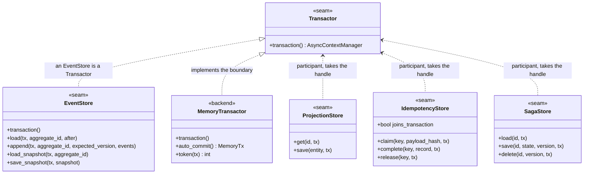
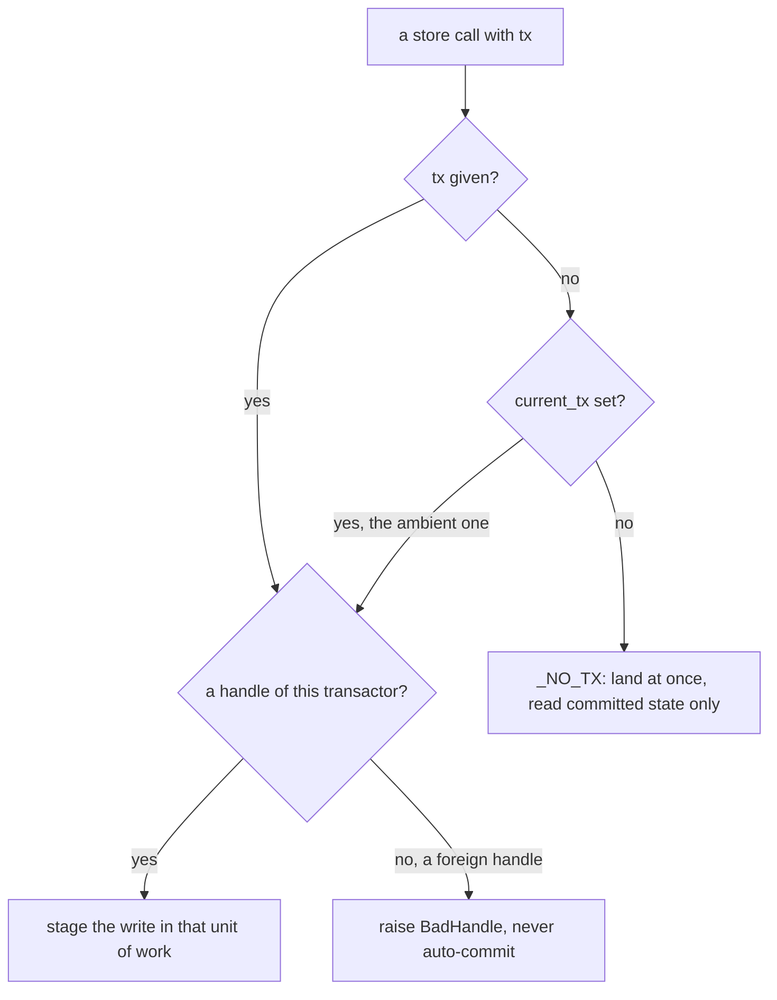
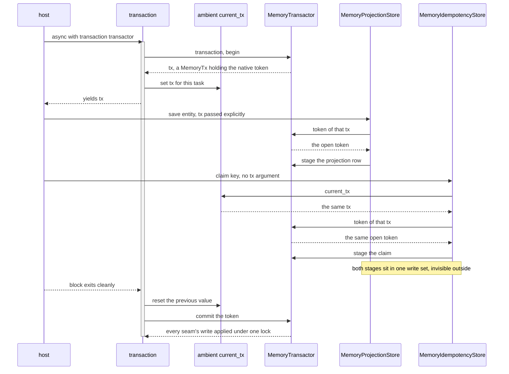

# Transactions — the unit of work

The `Transactor` seam. The ambient transaction Python participants join. The explicit handle Rust
threads instead. The `joins_transaction` declaration that tells the idempotency guard which world it
is in.

A unit of work is one transaction boundary several stores share. The event store, the projection
store, the saga store and the idempotency ledger are **pure participants**. Each takes a handle it
did not open. Each writes through it and never commits. One object owns the boundary, and that
object is the `Transactor`.



## The contract in full

The `Transactor` Protocol has exactly one method, and a docstring that is the specification:

| Clause | What a backend must guarantee |
|---|---|
| scope | `transaction()` returns an async context manager. A clean exit **commits**; an exception **rolls back** and re-raises. |
| isolation | Nothing written through the yielded `tx` is visible to other transactions before commit. |
| one handle | The yielded `tx` is one backend handle that **every** participant store accepts. Writes through it are atomic as a set: all commit or none. |
| read-your-writes | A participant handed the same `tx` reads its own uncommitted writes. `Repository.load` after `Repository.save` in one `transaction` sees the appended events. |
| no nesting | The software development kit (SDK) never nests. `Repository` and the stores join the ambient `current_tx` instead of opening a second one, so no savepoint support is needed. Nesting `transaction` yourself is undefined. |
| threading | The handle is used from one asyncio task at a time; no thread safety required. |

Rust states the same boundary as three methods plus a scoped helper:

```rust
pub trait Transactor {
    type Tx;
    fn begin(&self) -> Result<Self::Tx, Error>;
    fn commit(&self, tx: Self::Tx) -> Result<(), Error>;
    fn rollback(&self, tx: Self::Tx);
    fn transaction<R>(&self, body: impl FnOnce(&mut Self::Tx) -> Result<R, Error>) -> Result<R, Error>;
}
```

`transaction` is the free-function form. A table-driven test pins its branches. A clean body commits. A
failing body rolls back and never commits. A refused commit surfaces and does not also roll back. A
refused begin runs neither the body nor a rollback.

An `EventStore` **is** a `Transactor` in both SDKs. The simplest wiring therefore needs no separate
object. `async with transaction(store)` opens the store's own unit of work. A backend may also implement
`Transactor` standalone and hand the same handle to every store — which is what `MemoryTransactor`
does.

The four clauses are executed against the in-memory backend, in both languages, because the contract
is cross-language:

| Clause | Python test | Rust test |
|---|---|---|
| a raise leaves nothing behind | `test_a_raise_inside_a_transaction_leaves_nothing_behind` | `an_error_inside_a_transaction_leaves_nothing_behind` |
| a rolled-back claim releases its key | `test_a_rolled_back_claim_releases_the_key_...` | `a_rolled_back_claim_releases_the_key_...` |
| read-your-writes, invisible to others | `test_a_transaction_reads_its_own_uncommitted_writes_...` | `a_transaction_reads_its_own_uncommitted_writes_...` |
| a commit lands every participant together | `test_a_commit_makes_every_participants_write_visible_together` | `a_commit_makes_every_participants_write_visible_together` |

Python adds a fifth: a **cancelled** task rolls back too. Cancellation is a `BaseException`, not an
`Exception`, so a `wait_for` timeout must not leave half a unit of work committed.
`test_transactor.py::test_a_cancelled_unit_of_work_rolls_back` pins it.

## Python: the ambient transaction

Python's participants find the handle without it being threaded through every call. `transaction`
publishes the open handle in a `contextvars.ContextVar`, and `current_tx()` reads it:

```python
async with transactor.transaction() as tx:
    token = _current_tx.set(tx)
    try:
        yield tx
    finally:
        _current_tx.reset(token)
```

The function and the `Transactor` method share the name on purpose: `async with edax.transaction(store):`
opens the store's own unit of work and publishes it. `transaction(transactor, observer=...)` reports
each unit of work as `committed` or `rolled_back` with its duration. See
[observability.md](./observability.md).

A participant resolves its handle in three steps. The memory backend's `token` is the reference
implementation:

```python
def token(self, tx: Optional[Tx]) -> int:
    if tx is None:
        tx = current_tx()
    if tx is None:
        return _NO_TX
    if isinstance(tx, MemoryTx) and tx.transactor is self:
        return tx.token
    raise BadHandle(...)
```



| Resolution | Meaning |
|---|---|
| the explicit `tx` argument | the caller threaded a handle; use it |
| else the ambient `current_tx()` | a `transaction` is open in this task; enlist in it |
| else `_NO_TX` | outside any unit of work: the call lands at once and reads committed state only |
| a handle of another transactor | `BadHandle`. The store never auto-commits silently. |

`_NO_TX` is a real, explicit state, not an accident. `MemoryTransactor.auto_commit()` returns a
handle that names it. Use it for a reader that must look past an open unit of work, such as a test
probing what has actually landed.

`Repository` resolves the same way through `_enlist`: the explicit `tx`, else the ambient one, else
a unit of work of its own. When it opens its own, it opens it through `transaction`. The repository's
handle becomes the ambient one for the duration. A participant taking no explicit `tx` still joins
it.

### Two stores joining one open transaction



`test_transactor.py::test_one_tx_threaded_to_projection_and_idempotency` runs this and asserts the
projection row is staged, not landed, before the block exits. The native side applies the whole
write set under one lock, so no reader can observe half of it.

### The contextvar is per task, not process-wide

A task copies its creator's context at creation. Three consequences, all pinned by
`test_transactor.py::test_current_tx_is_per_task_not_process_wide`:

- a task that already existed before the `transaction` block never sees its handle.
- a task created **inside** the block inherits the handle — and keeps it after the block exits,
  which the `Transactor` contract forbids.
- the contextvar is reset on exit, so the handle never leaks past the call that owns it.

Start long-lived tasks outside a unit of work.

## Rust: no ambient transaction, so pass the handle

Rust has no counterpart to the contextvar, and that is not an oversight. The middleware chain is
synchronous, so there is no task whose task-locals could carry a handle. The host passes the handle
instead, either as an explicit `&mut Tx` or through a provider closure.

[Rust parity](./rust-parity.md) is the one home for both forms and for the full comparison table.

## joins_transaction

`joins_transaction` is an **optional class attribute** an `IdempotencyStore` declares. The guard
reads it reflectively, and the absence of it means `False`:

```python
def joins_transaction(store: IdempotencyStore) -> bool:
    return bool(getattr(store, "joins_transaction", False))
```

`getattr` with a default, rather than a required Protocol member, so an existing store keeps working
unchanged.

The guard branches on it. It **cannot detect** the answer. A store that accepts `tx` and ignores it
is indistinguishable from one that enlists, until the rollback that should have dropped the claim
does not.

**Why `False` is the default.** The two mistakes are not symmetric:

- a needless compensation, on a store that did enlist, costs one no-op delete. The rollback already
  dropped the claim.
- a **skipped** compensation, on a store that did not enlist, leaves a `done` record for work that
  rolled back. A redelivery then replays a result that never landed. Silent loss.

The cheap mistake is the default.

**What `True` obliges a store to do.** It must refuse a handle belonging to another database. It
raises `BadHandle` rather than silently auto-committing. The guard skips a compensation the store
would otherwise have to provide. `MemoryTransactor.token` does exactly that.

[Idempotency](./idempotency.md#the-two-modes) is the one home for the two guard modes, their
orderings and the guarantee each one buys.

## Boundary rules

**A dispatcher worker clears the ambient transaction.** `KeyOrderedDispatcher` sets `_current_tx` to
`None` as the first statement of every worker task:

> A task copies its creator's context, so a dispatcher started inside `transaction` would hand every
> handler that caller's tx: long after it committed, and from a second task, which the `Transactor`
> contract forbids. A worker is its own unit-of-work boundary.
> — the `KeyOrderedDispatcher` worker contract

A worker outlives the block that started it and serves many messages. Inheriting one handle would
mean every handler it ever runs writes through a committed transaction. Clearing it makes each
handler start clean, and open its own unit of work if it needs one.

That has a consequence on the consume path. A handler that opens a transaction internally opens it
after the guard already took its claim. A commit that fails after the guard returned is a failure
the guard never sees. This is why the consume-path guards take `unit_of_work=` — see
[idempotency](./idempotency.md).

**A foreign handle raises `BadHandle`.** A handle from another transactor names a unit of work this
store's database knows nothing about. Enlisting anyway would silently drop the atomicity the caller
asked for. The store fails fast instead. That holds whether the handle was passed explicitly or
picked up from the ambient contextvar. The message names the fix: build every memory store that must
commit together over one `MemoryTransactor`.

`BadHandle` is **terminal**. The same handle fails the same way on every retry. A transient verdict
would have the dispatcher redeliver a wiring mistake forever. The Rust adapter refuses an unknown
transaction token with the same code (`edax_adapters::unknown_tx`), so both SDKs give a misrouted
handle one verdict. See [errors.md](./errors.md).

**Do not nest.** The SDK never opens a second unit of work inside an open one. The idempotency guard
enforces this actively. Given `unit_of_work=` while `current_tx()` is already set, it raises
`BadHandle`. It will not commit the claim independently of the writes it guards.

**Isolation in the memory backend is by exclusion, not by blocking.** A key one open transaction
staged is held until that transaction ends. A second writer gets `ConcurrencyError` at once rather
than waiting. A durable store would park the second writer on a row lock. An in-memory store driven
from one asyncio loop cannot park anyone without deadlocking the loop. So it reports the conflict as
the reload-and-retry signal the writer would have got anyway. See [memory
backend](../backends/memory.md).

## Wiring

The one wiring snippet lives in [step 3 of getting
started](../guides/getting-started.md#step-3--one-transaction-around-the-dispatch).

Every store there is built over the one `MemoryTransactor`. That is what makes their writes one unit
of work. Build them over separate transactors and each gets a database of its own. The writes then
commit independently. The foreign-handle check reports it the first time you pass a handle across.

## See also

- [Aggregates](./aggregates.md) — `Repository.load` / `save`, the biggest participant.
- [Outbox](./outbox.md) — the rows that must commit with the events.
- [Idempotency](./idempotency.md) — both guard modes and what `joins_transaction` buys each.
- [Commands](./commands.md) — where the host opens the unit of work around a dispatch.
- [Memory backend](../backends/memory.md) — `MemoryTransactor` and its four stores.
- [Redis backend](../backends/redis.md) — a ledger that cannot join, and the fence it uses instead.
- [Delivery guarantees](../guides/delivery-guarantees.md) — the end-to-end matrix.
