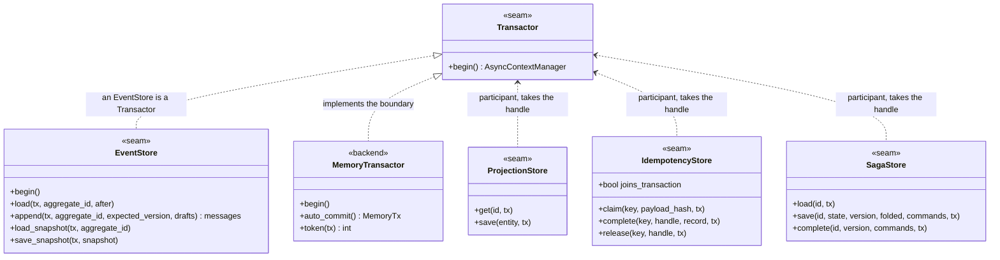
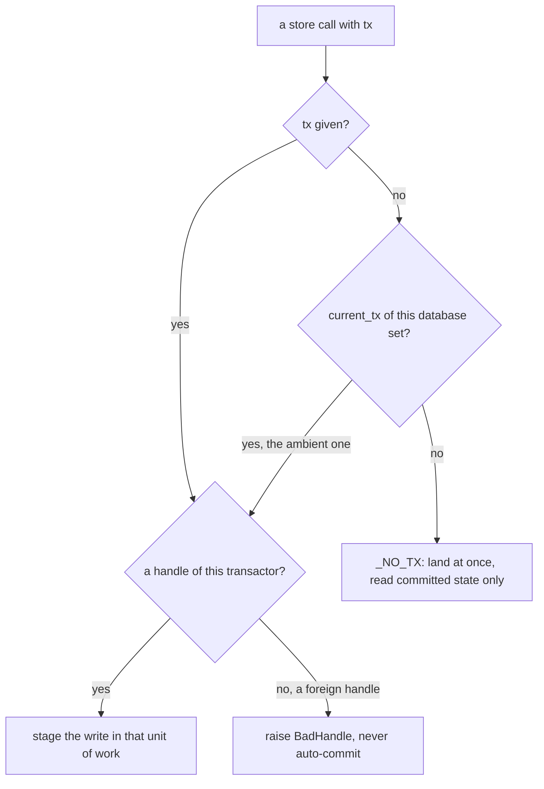
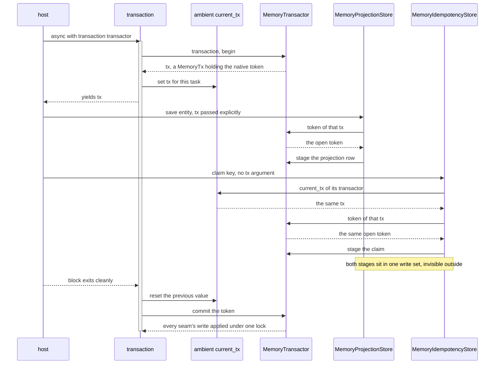

# Transactions: the unit of work

The `Transactor` seam. The ambient transaction Python participants join. The explicit handle Rust
threads instead. The `joins_transaction` declaration that tells the idempotency guard which world it
is in.

A unit of work is one transaction boundary several stores share. The event store, the projection
store, the saga store and the idempotency ledger are pure participants. Each takes a handle it
did not open. Each writes through it and never commits. One object owns the boundary, and that
object is the `Transactor`.



## The contract in full

The `Transactor` Protocol has one method, and its docstring is the specification:

| Clause | What a backend must guarantee |
|---|---|
| scope | `begin()` returns an async context manager. A clean exit commits; an exception rolls back and re-raises. |
| one opener | `begin()` is the backend's hook. A host opens every unit of work with `edax.transaction(t)`, which calls it. A raw `begin()` publishes no `current_tx`, so a `Repository.save` given no tx inside it would commit on its own and the nesting guard would not see it. |
| isolation | Nothing written through the yielded `tx` is visible to other transactions before commit. |
| one handle | The yielded `tx` is one backend handle that every participant store accepts. Writes through it are atomic as a set: all commit or none. |
| read-your-writes | A participant handed the same `tx` reads its own uncommitted writes. `Repository.load` after `Repository.save` in one `transaction` sees the appended events. |
| no nesting | The software development kit (SDK) never nests. `Repository` and the stores join the ambient `current_tx` of their own transactor instead of opening a second one, so no savepoint support is needed. A second `transaction` on the same transactor raises `BadHandle`; one over another database nests, and each database's stores see only its own unit of work. |
| identity | An object whose `begin()` only delegates to another transactor names that transactor as its `transactor` attribute, so `transaction(store)` and `transaction(store.transactor)` open the same unit of work and every store over the database finds it. The SDK follows the attribute one hop, never a chain. |
| threading | The handle is used from one asyncio task at a time; no thread safety required. |

Rust states the same boundary as a trait. `transaction` has a default body. `identity` has none, so
every backend names the database it opens units of work on:

```rust
pub trait Transactor {
    type Tx;
    fn identity(&self) -> usize; // the database: equal for two transactors over one database
    fn begin(&self) -> Result<Self::Tx, Error>;
    fn commit(&self, tx: Self::Tx) -> Result<(), Error>;
    fn rollback(&self, tx: Self::Tx);
    fn transaction<R, E: From<Error>>(&self, body: impl FnOnce(&mut Self::Tx) -> Result<R, E>) -> Result<R, E>;
}
```

`transaction` is the free-function form. A table-driven test pins its branches. A clean body commits. A
failing body rolls back and never commits. A refused commit surfaces and does not also roll back. A
refused begin runs neither the body nor a rollback. A unit of work opened on a database that already has
one open on the thread is refused with `BadHandle` before it begins; `identity` decides which database.
So `Repository::save` inside a host's body can never commit apart from the host. `save_in` joins instead.

An `EventStore` is a `Transactor` in both SDKs. The simplest wiring therefore needs no separate
object. `async with transaction(store)` opens the store's own unit of work. A backend may also implement
`Transactor` standalone and hand the same handle to every store, as `MemoryTransactor` does.

The four clauses are executed against the in-memory backend, in both languages, because the contract
is cross-language:

| Clause | Python test | Rust test |
|---|---|---|
| a raise leaves nothing behind | `test_a_raise_inside_a_transaction_leaves_nothing_behind` | `an_error_inside_a_transaction_leaves_nothing_behind` |
| a rolled-back claim releases its key | `test_a_rolled_back_claim_releases_the_key_...` | `a_rolled_back_claim_releases_the_key_...` |
| read-your-writes, invisible to others | `test_a_transaction_reads_its_own_uncommitted_writes_...` | `a_transaction_reads_its_own_uncommitted_writes_...` |
| a commit lands every participant together | `test_a_commit_makes_every_participants_write_visible_together` | `a_commit_makes_every_participants_write_visible_together` |

Python adds a fifth: a cancelled task rolls back too. Cancellation is a `BaseException`, not an
`Exception`, so a `wait_for` timeout must not leave half a unit of work committed.
`test_transactor.py::test_a_cancelled_unit_of_work_rolls_back` pins it.

## Python: the ambient transaction

Python's participants find the handle without it being threaded through every call. `transaction`
publishes the open handle in a `contextvars.ContextVar`, keyed by the database it belongs to, and
`current_tx(transactor)` reads the one of that database:

```python
database = id(_database(transactor))  # follows `.transactor` to the transactor that owns the database
async with transactor.begin() as tx:
    token = _ambient.set({**_ambient.get(), database: tx})
    try:
        yield tx
    finally:
        _ambient.reset(token)
```

The map is keyed by database. One slot for every database would hand every orders store the audit
handle under `transaction(orders)` around `transaction(audit)`. Memory refuses that handle as
foreign; a SQL store that does not check would write through the other database's connection. Keyed,
each store asks for its own database's tx. So two databases nest, and each commits or rolls back on
its own.
`test_transactor.py::test_two_databases_nest_and_each_store_joins_its_own` runs all four outcomes.

The hook and the opener have different names on purpose. `async with edax.transaction(store):` opens
the store's own unit of work through `store.begin()` and publishes it. No method named `transaction`
opens one unpublished, so a host cannot call the wrong one. `transaction(transactor, observer=...)` reports
each unit of work as `committed` or `rolled_back` with its duration. See
[observability.md](./observability.md).

A participant resolves its handle in three steps. The memory backend's `token` is the reference
implementation:

```python
def token(self, tx: Tx | None) -> int:
    if tx is None:
        tx = current_tx(self)
    if tx is None:
        return _NO_TX
    if isinstance(tx, MemoryTx) and tx.transactor is self:
        return tx.token
    raise BadHandle(...)
```



| Resolution | Meaning |
|---|---|
| the explicit `tx` argument | the caller threaded a handle; use it |
| else the ambient `current_tx(transactor)` | a `transaction` over this store's database is open in this task; enlist in it. Another database's is invisible here. |
| else `_NO_TX` | outside any unit of work: the call lands at once and reads committed state only |
| a handle of another transactor | `BadHandle`. The store never auto-commits silently. |

`_NO_TX` is an explicit state. `MemoryTransactor.auto_commit()` returns a handle that names it. Use
it for a reader that must look past an open unit of work, such as a test probing what has landed.

`Repository` resolves the same way through `_enlist`: the explicit `tx`, else the ambient one of its
store's database, else a unit of work of its own. It opens its own through `transaction`, so the
repository's handle becomes the ambient one for the duration. A participant taking no explicit `tx` still joins
it.

### Two stores joining one open transaction



`test_transactor.py::test_one_tx_threaded_to_projection_and_idempotency` runs this and asserts the
projection row is staged, not landed, before the block exits. The native side applies the whole
write set under one lock, so no reader can observe half of it.

### The contextvar is per task, not process-wide

A task copies its creator's context at creation. Three consequences, all pinned by
`test_transactor.py::test_current_tx_is_per_task_not_process_wide`:

- a task that already existed before the `transaction` block never sees its handle.
- a task created inside the block inherits the handle, and keeps it after the block exits, which
  the `Transactor` contract forbids.
- the contextvar is reset on exit, so the handle never leaks past the call that owns it.

Start long-lived tasks outside a unit of work.

## Rust: no ambient transaction, so pass the handle

Rust has no counterpart to the contextvar. The middleware chain is
synchronous, so there is no task whose task-locals could carry a handle. The host passes the handle
instead, either as an explicit `&mut Tx` or through a provider closure.

[Rust parity](./rust-parity.md) is the one home for both forms and for the full comparison table.

## joins_transaction

`joins_transaction` is an optional class attribute an `IdempotencyStore` declares. The guard
reads it reflectively, and the absence of it means `False`:

```python
def joins_transaction(store: IdempotencyStore) -> bool:
    return bool(getattr(store, "joins_transaction", False))
```

`getattr` with a default, rather than a required Protocol member, so an existing store keeps working
unchanged.

The guard branches on it and cannot detect the answer. A store that accepts `tx` and ignores it
is indistinguishable from one that enlists, until the rollback that should have dropped the claim
does not.

`False` is the default because the two mistakes cost different amounts:

- a needless compensation, on a store that did enlist, costs one no-op delete. The rollback already
  dropped the claim.
- a skipped compensation, on a store that did not enlist, leaves a `done` record for work that
  rolled back. A redelivery then replays a result that never landed, and nothing reports it.

The cheap mistake is the default.

`True` obliges a store to refuse a handle belonging to another database. It raises `BadHandle`
instead of auto-committing, because the guard skips the compensation for it. `MemoryTransactor.token`
does that.

[Idempotency](./idempotency.md#the-two-modes) is the one home for the two guard modes, their
orderings and the guarantee each one buys.

## Boundary rules

**A dispatcher worker clears the ambient transaction.** `KeyOrderedDispatcher` empties the ambient
map as the first statement of every worker task. A task copies its creator's context, so a
dispatcher started inside `transaction` would otherwise hand every handler that caller's tx from a
second task, which the `Transactor` contract forbids.

A worker outlives the block that started it and serves many messages. Inheriting one handle would
mean every handler it ever runs writes through a committed transaction. Clearing it makes each
handler start clean, and open its own unit of work if it needs one.

That has a consequence on the consume path. A handler that opens a transaction internally opens it
after the guard already took its claim. A commit that fails after the guard returned is a failure
the guard never sees. So the consume-path guards take `unit_of_work=`; see
[idempotency](./idempotency.md).

**A foreign handle raises `BadHandle`.** A handle from another transactor names a unit of work this
store's database knows nothing about. Enlisting anyway would silently drop the atomicity the caller
asked for. The store fails fast instead. The ambient contextvar never hands a store another database's
handle, so this is the explicit path. The message names the fix: build every memory store that must
commit together over one `MemoryTransactor`.

`BadHandle` is terminal. The same handle fails the same way on every retry. A transient verdict
would have the dispatcher redeliver a wiring mistake forever. The Rust store refuses an unknown
transaction token with the same code (`edax_memory::unknown_tx`), so both SDKs give a misrouted
handle one verdict. See [errors.md](./errors.md).

**Nesting is refused.** The SDK never opens a second unit of work inside an open one, and neither may
you. `transaction(t)` while `t` already has one open raises terminal `BadHandle`. The inner block
would commit on its own clean exit, and the outer rollback could not take those writes back.

Nobody writes `transaction()` inside `transaction()` on purpose. It happens when one service
function that opens a unit of work calls another that does the same. Compose those two by passing
the tx down, or by moving the `transaction` out to their shared caller.

A second transactor, over another database, still nests. The guard compares transactor identity, so
only a second unit of work on the same transactor is refused. Two transactor objects over
one connection pool are two identities and are not caught; one transactor per database is the wiring
this assumes. Neither nested commit is atomic with the other's: two databases cannot commit
together, so treat that pair as a [saga](./sagas.md).

The idempotency guard enforces its own case. Given `unit_of_work=` while any `transaction` is already
set, it raises `BadHandle` rather than committing the claim independently of the writes it guards.

**Isolation in the memory backend is by exclusion, not by blocking.** A key one open transaction
staged is held until that transaction ends. A second writer gets `ConcurrencyError` at once rather
than waiting. A durable store would park the second writer on a row lock. An in-memory store driven
from one asyncio loop cannot park anyone without deadlocking the loop. So it reports the conflict as
the reload-and-retry signal the writer would have got anyway. See [memory
backend](../backends/memory.md).

## Wiring

The one wiring snippet lives in [step 3 of getting
started](../guides/getting-started.md#step-3--one-unit-of-work-per-dispatch-and-retry-around-it).

Every store there is built over the one `MemoryTransactor`. That is what makes their writes one unit
of work. Build them over separate transactors and each gets a database of its own. The writes then
commit independently. The foreign-handle check reports it the first time you pass a handle across.

## See also

- [Aggregates](./aggregates.md) — `Repository.load` / `save`, the biggest participant.
- [Outbox](./outbox.md) — the rows that must commit with the events.
- [Idempotency](./idempotency.md) — both guard modes and what `joins_transaction` buys each.
- [Commands](./commands.md) — where the host opens the unit of work around a dispatch.
- [Memory backend](../backends/memory.md) — `MemoryTransactor` and its four stores.
- [Redis backend](../backends/redis.md) — a ledger that cannot join, and the fence it uses instead.
- [Delivery guarantees](../guides/delivery-guarantees.md) — the end-to-end matrix.
